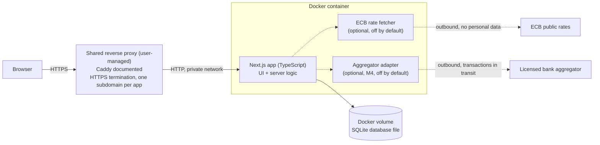

# Architecture

This document describes how Demain is meant to be built and deployed, and records the technical decisions with their context, the alternatives rejected and their consequences. Nothing here is implemented yet; see [ROADMAP.md](ROADMAP.md) for the order of work. The domain vocabulary is defined in [DOMAIN.md](DOMAIN.md).

## Overview

Demain is a single Next.js application running in one Docker container, storing everything in one SQLite file on a Docker volume. HTTPS is terminated by a reverse proxy run by the user, shared with any other application on the same host. Two optional components make outbound calls and are disabled by default.



Dashed arrows are optional and disabled by default. With default settings, the app makes no outbound network call.

## Module boundaries

The application is split into modules with explicit responsibilities. The projection and recurrence logic is pure (no database, no clock, no network) so that it can be tested in isolation.

| Module | Responsibility | Depends on |
| --- | --- | --- |
| **auth** | Single-user account, first-run setup token, password hashing, sessions, optional TOTP with backup codes, offline password recovery, login rate limiting. | storage |
| **ledger** | Accounts (with deposit ceilings), transactions, transfers, categories, balance assertions, monthly synthesis, real chart data. | storage, currency |
| **import** | CSV and OFX parsing, column mappings, deduplication, categorization rules, the to-categorize queue. Later hosts the aggregator adapter interface (M4). | ledger, planning (for matching) |
| **planning** | Planned items and their versions, occurrence generation, overrides, business-day rules, rolling-average amounts, provisions, planned vs actual matching, calendar data. | ledger, currency |
| **scenarios** | Constant-pace simulation, estimated variable spending, scenarios, modifications, the cash flow transformation engine, indicators, comparison, validation into planned items. | planning, currency |
| **currency** | Minor unit arithmetic, parsing and formatting of amounts, exchange rates, conversion to the reference currency, optional ECB fetcher. | storage |
| **i18n** | Translation files (French and English at launch), language negotiation, locale-aware formatting of dates, numbers and amounts. See ADR-014. | none |
| **export** | Encrypted database snapshot and its restoration, JSON export. | storage, auth (to sign everyone out after a restore) |
| **storage** | Drizzle schema, migrations, database access. Only module that talks to SQLite. | none |

Rules:

- UI components do not access the database; they call server-side functions of the modules.
- Domain computations (occurrences, matching, projections, indicators) receive "today" and all data as inputs; they never read the clock or the database themselves.
- The import module depends on interfaces for bank sources (file import now, aggregator later), so adding M4 does not change the rest of the app.
- Estimations of unplanned spending exist only in the scenarios module. The ledger and planning modules never estimate: the real trajectory is made of real transactions and explicitly dated planned items. The only averaging outside simulations is the rolling-average amount of a planned item, which the user chooses item by item.
- Money enters and leaves the application as text and is converted to integer minor units on input, never through a floating-point number; it is converted back to a decimal string only for display and export.

## Decision records

Each record follows the same structure: context, decision, alternatives rejected, consequences.

### ADR-001: Build from scratch

**Context.** Mature open source, self-hosted budget apps exist, notably Actual Budget and Firefly III. The owner estimates they cover roughly 70% of the need: budgeting, bank file import, categorization.

**Decision.** Build Demain from scratch.

**Alternatives rejected.**

- *Adopt Actual Budget or Firefly III.* They do not offer a comparative scenario engine (several possible futures side by side with indicators), which is the core of Demain. The planned item model (one entity for recurrences and one-off events, versions with effective dates, occurrences computed for unlimited horizons, matching with tolerances) does not map well onto their data models.
- *Contribute the missing features upstream.* The scenario engine touches the data model deeply; imposing it on an existing project with its own direction is unlikely to be welcome and would be slower than a focused app.

**Consequences.** More work for M1, which rebuilds basic ledger features that already exist elsewhere. In exchange, the data model is designed around projection and scenarios from the start. Actual Budget and Firefly III remain valid, more mature choices for users who do not need simulations, and the README should say so once the project is public.

### ADR-002: Next.js and TypeScript strict

**Context.** One developer, one deployable unit, a web UI with server-side logic, and a domain where type errors (amounts, dates, currencies) are costly.

**Decision.** Next.js with TypeScript in strict mode, no `any` (use `unknown` and narrowing). UI and server logic live in one application and one container.

**Alternatives rejected.**

- *Separate frontend and API services.* Two deployables and an API contract to maintain, with no benefit for a single-user app.
- *Plain JavaScript.* Loses compile-time checks on exactly the code that matters most (money and dates).

**Consequences.** One build, one image, one process. The domain logic must still be kept out of UI components (see [Module boundaries](#module-boundaries)) so it stays testable and independent of the framework.

### ADR-003: SQLite through Drizzle ORM

**Context.** Single user, a few thousand transactions per year, self-hosting by non-experts on modest hardware.

**Decision.** SQLite as the database, accessed through Drizzle ORM, with the database file stored in a Docker volume.

**Why SQLite.**

- A single file in a volume: no second container, no exposed database port, nothing extra to secure.
- Backup is a file copy made safely (see [Backups](#backups)).
- The expected data volume is far below SQLite's limits.
- Simple for other people to self-host.

**Costs accepted.**

| Cost | Mitigation |
| --- | --- |
| Single writer at a time | Fine for a single user. |
| Looser typing than PostgreSQL | Amounts as integer minor units, schema validation in the application, strict TypeScript types from Drizzle. |
| More limited schema migrations (some column changes need table rebuilds) | Drizzle generates and versions migrations. |
| No native encryption at rest | See [ADR-005](#adr-005-encryption-at-rest-delegated-to-the-host). |

**Alternatives rejected.**

- *PostgreSQL.* A second container and a credential to manage, for concurrency the app does not need.

**Reversal conditions.** Revisit if Demain needs multi-user concurrent access or real-time sync across devices. Drizzle supports PostgreSQL, which keeps a migration path open.

**Consequences.** The SQLite driver for Node.js is a native dependency; the multi-architecture image must build it for each target (see [ADR-004](#adr-004-one-multi-architecture-docker-container)).

### ADR-004: One multi-architecture Docker container

**Context.** The owner has no VPS yet and wants Demain to run anywhere: a PC, a VPS or a Raspberry-class machine. Other self-hosters have the same variety.

**Decision.** Ship one Docker image built for x86-64 (`linux/amd64`) and 64-bit ARM (`linux/arm64`). Data lives in a Docker volume. Configuration comes only from environment variables. The image is published on GitHub Container Registry, next to the CI that builds it.

**Alternatives rejected.**

- *Native installers per OS.* Much more packaging work for little gain over Docker.
- *Several containers (app, database, worker).* No need given ADR-002 and ADR-003.
- *Docker Hub.* Works, but adds a second account and secrets to manage when the code and the CI already live on GitHub.

**Consequences.** Users need Docker. 32-bit ARM is not targeted. Native dependencies must be built per architecture in CI.

### ADR-005: Encryption at rest delegated to the host

**Context.** Financial data is sensitive. SQLite has no native encryption at rest.

**Decision.** Encryption at rest is delegated to the host (full-disk encryption or an encrypted volume), and the documentation explains how. Backups use a password-encrypted snapshot of the database produced by the app, plus a documented procedure to back up the Docker volume. A JSON export is available for portability (see [Backups](#backups)).

**Alternatives rejected.**

- *SQLCipher in V1.* Heavier image and an additional native dependency to build for every architecture, for a protection the host can provide.

**Reversal conditions.** Revisit if the database file must leave the host disk (for example, automatic off-site sync of the raw file).

**Consequences.** On a host without disk encryption, the database file is readable by anyone with access to the volume. The documentation must state this plainly. With several applications on the same host, disk encryption matters more, not less.

### ADR-006: HTTPS delegated to a shared reverse proxy, Caddy documented

**Context.** Ports 80 and 443 of a host can be used by one process only, and the host may run other applications next to Demain (the owner plans a second system). Certificate management differs from one setup to another.

**Decision.** The container serves HTTP on a private port that is never published on the host. HTTPS is terminated by a single reverse proxy shared by all the applications of the host, which routes by host name. Demain gets its own subdomain (for example `demain.example.com`), not a sub-path. The proxy is not part of Demain's compose file: Demain joins an external Docker network that the proxy also joins. Caddy is the documented proxy, with one complete example. The documentation also lists what Demain expects from any proxy: terminate HTTPS, forward the original host and protocol (the `Host` header must reach the app unchanged, Server Actions refuse a request whose `Origin` differs from it), put the client address as the last entry of `X-Forwarded-For` (login rate limiting is counted per address), never expose the app port directly.

**Alternatives rejected.**

- *Traefik.* Label-based discovery is attractive with many containers, but it normally needs access to the Docker socket, which is equivalent to root on the host: a poor trade for an application holding financial data. Its concepts (entrypoints, routers, services, middlewares) are also heavy for a single service.
- *nginx.* Very common and well documented, but it has no automatic HTTPS (a certificate client and a renewal job must be added and maintained) and its configuration is more verbose, leaving more room for a missing security header.
- *Built-in TLS and certificate management.* Duplicates what proxies do well, complicates the image, and cannot share ports with other applications.
- *Serving under a sub-path.* Next.js supports a base path, but it is a recurring source of bugs (links, cookies, static assets) with no benefit.

**Consequences.** One shared proxy is a single point to keep secure and up to date. Only ports 22, 80 and 443 should be open on the host. Applications must not share volumes or databases: they share only the proxy network, so a compromised neighbor cannot read Demain's data directly. Session cookies are marked `Secure`, so the app is expected to be reached over HTTPS (a local-only development mode is the exception). Users of Traefik or nginx follow the list of expectations instead of a maintained example.

### ADR-007: Amounts as integer minor units, dated exchange rates

**Context.** Binary floating point cannot represent most decimal amounts exactly, and totals drift. The app is multi-currency from day one.

**Decision.** All amounts are integers in the currency's minor unit (cents for EUR), converted to a decimal only for display. Text amounts are parsed by string handling, never through a floating-point number, including when reading CSV, OFX and sheet files. Each account has a currency; transactions inherit it. Totals use one user-chosen reference currency, converted with dated exchange rates stored in the database. Rates are entered manually by default; an optional fetch of public ECB reference rates exists but is **disabled by default**.

**Alternatives rejected.**

- *Floats or decimals as strings everywhere.* Floats are wrong; decimal strings make arithmetic error-prone.
- *Automatic rate fetch on by default.* It is an outbound call, which breaks the default "nothing leaves the server" promise even if no personal data is sent.

**Consequences.** Every division (averages, percentages, interest, loan payments) needs an explicit rounding step, which is tested. Exchange rates are stored as integers scaled by 10^8 (`1.0821` is `108210000`), read from text by string handling and applied with `BigInt` so that the intermediate product cannot lose precision; a result outside the safe integer range is refused. Eight decimals cover the precision of the ECB feed and the smallest rates between common currencies, at the cost of a maximum rate of about 90 million, far above any real pair. Each flow is converted and rounded on its own, at the rate of its date, and balances are converted at the end of their month. Simulations in the reference currency depend on the latest known rate.

### ADR-008: License AGPL-3.0

**Context.** Demain is server software meant to be self-hosted. The owner wants personal self-hosting to stay frictionless, while preventing a closed hosted fork.

**Decision.** AGPL-3.0.

**Alternatives rejected.**

- *MIT.* Simple and permissive, but allows anyone to run a modified version as a closed hosted service without sharing changes.
- *GPL-3.0.* Its obligations trigger on distribution; offering the software over a network is not distribution, so a hosted fork could stay closed.

**Consequences.** Anyone who runs a modified Demain for users over a network must offer them the source of that version. Personal self-hosting, modified or not, is unaffected in practice. Some companies avoid AGPL dependencies; this is acceptable for an end-user app.

### ADR-009: Bank sync only through an optional aggregator adapter

**Context.** Under PSD2, access to bank account data APIs is reserved to licensed providers; an individual cannot call these APIs directly for their own account. Demain must work with any bank.

**Decision.** V1 imports files only (CSV and OFX), fully local. Bank sync arrives in M4 through an aggregator behind an adapter interface, optional and disabled by default. The app must work fully without it.

**Alternatives rejected.**

- *Bank sync in V1.* Ties the app to a third party and its terms before the core value exists.
- *Scraping bank websites.* Fragile, often against bank terms, and requires storing bank credentials.

**Consequences.** The privacy trade-off must be explicit to users: with sync enabled, **storage stays local but transit does not**. The aggregator sees the transactions it relays. Which aggregator, at what price and under which terms is not decided; offers must be verified at implementation time (see [ROADMAP.md](ROADMAP.md#open-questions)).

### ADR-010: Deterministic, rule-based categorization

**Context.** Imported transactions need categories, and data must not leave the server.

**Decision.** User-defined rules (for example, label contains a text gives a category), bootstrapped from the sheet history. The app suggests a rule when the user categorizes by hand. Unmatched transactions go to a to-categorize queue.

**Alternatives rejected.**

- *Learned models or external categorization services.* Opaque results, and external services would send data off the server.

**Consequences.** Categorization is predictable and explainable ("this rule matched"). It needs some setup at first, which the suggestions of the import reduce.

### ADR-011: Estimation only inside simulations

**Context.** The owner wants the main views to show only what is real or explicitly planned and dated ("no guess that I might go out this month"). At the same time, a simulation is only useful if it can say what happens if life continues at the same pace.

**Decision.** The real trajectory (chart, calendar, monthly lines) contains real transactions and explicitly dated planned items, never an estimation of unplanned spending. Estimation (rolling average of recent months per category) exists only in simulations, starting with the constant-pace simulation that is always present as a reference. A planned item may follow a rolling average of its own previous occurrences, but only because the user chose that mode for that item.

**Alternatives rejected.**

- *An always-on projection of variable spending in the main views.* It mixes facts and guesses in the same curve and makes it impossible to tell what is real.
- *Comparing the real trajectory directly with scenarios.* It would mix the effect of a decision with the effect of the estimation. All simulations share the real history and diverge from today, the constant-pace simulation being the fair reference.

**Consequences.** Two computations coexist and must be kept separate (see the rule in [Module boundaries](#module-boundaries)). The comparison view draws the real months once, then one curve set per simulation.

### ADR-012: Charts as hand-written SVG

**Context.** Demain needs a few simple charts: month-end curves for two to four series, bars, a category breakdown. The requirements are mostly about accessibility: planned values drawn differently from real ones without relying on color, an equivalent data table for every chart, keyboard operability. The first chart ships with M1.

**Decision.** Charts are React components rendering SVG, using only the `d3-scale` and `d3-shape` modules for scales and path generation. No charting framework.

**Alternatives rejected.**

- *Recharts or visx.* Faster to start, but heavier or lower level, and the accessibility requirements (patterns, markers, data tables) would still be written by hand, around the library.
- *Canvas libraries (Chart.js and similar).* Canvas output is not accessible to screen readers, so every chart would need a duplicated DOM version.
- *ECharts or Plotly.* Large and oversized for four simple charts.

**Consequences.** More initial code to write: axes, ticks, hover and focus, responsive width. In exchange, a small footprint, full control of dashed lines, markers and tables, server-side rendering for free, and no chart framework to keep updated. A shared set of small chart primitives should be built once and reused by the real chart and the simulation diagrams.

### ADR-013: Overflow chains at account level, protected against cycles

**Context.** The Livret Jeune has a ceiling of 1 600 EUR and the surplus goes to the Livret A. Recurring transfers will reach such ceilings in the future, when no one is there to answer a question. The configuration comes from user input and cannot be trusted.

**Decision.** The ceiling and the overflow account are properties of the account, not of each planned item. Chains of overflow accounts are allowed. Manual transfers show the split and let the user choose; planned and simulated transfers follow the chain automatically, and what fits nowhere stays in the source account. The chain is validated on every save and on every load of external data (no cycle, same currency, no archived target, referenced accounts cannot be archived or deleted), and evaluated with a visited set so that a corrupted chain can never loop.

**Alternatives rejected.**

- *Overflow account chosen per planned item.* Repeats the same rule in every item and lets items disagree with each other.
- *A warning only, resolved by hand each time.* It is what the sheet required, and it is the manual work Demain exists to remove.
- *A single level of overflow.* Does not cover an account that overflows to a second capped account.

**Consequences.** The account screen must validate a graph, not just a field. The routing logic is a pure function shared by manual entry, planned items, simulations and the import of files, and it needs thorough tests for cycles and partial fits. The import of files uses the same pure routing, fed with running balances (ADR-016).

### ADR-014: Language from a cookie, translation files discovered on disk, domain messages as keys

**Context.** The interface must exist in French and English from the first milestone, and a contributor must be able to add a language without touching the code. The domain is pure and must stay free of any language, yet its validation errors are shown to the user.

**Decision.** One JSON file per language in `messages/`, named after its BCP 47 tag, `en.json` being the reference. The language of a request is the cookie set by the header selector, then the `Accept-Language` header, then English; there is no locale prefix in the URLs. The domain raises a message reference (a key of the `feedback` namespace plus values) next to its English log message, and the application translates it on the server. Calendar dates are shown as UTC days, and "today" follows the time zone of the server (`TZ`).

**Alternatives rejected.**

- *A locale prefix in the URL (`/fr`, `/en`).* Useful for search engines, pointless for a private authenticated app, and it complicates every link and redirect.
- *A static registry of languages in the code.* Safer for bundling, but adding a language would then require a code change.
- *Translating in the domain.* Ties the pure core to a language and to a request context.

**Consequences.** The `messages/` directory is read at runtime and must ship next to the application, which the Docker packaging has to account for. A test checks that every file has the keys and placeholders of the reference. A new domain error needs its key in the translation files and its reference at the throw site.


### ADR-015: Notices as toasts, carried by a short-lived cookie

**Context.** Server actions refuse or accept what the user asked, and the user must be told in both cases, whichever screen or form it came from. Errors that no field explains were rendered by each form on its own, and the actions behind the confirmation dialogs (archive, delete) told nothing: a refusal there was an unhandled exception. A notice also has to survive a redirect, as after an edit.

**Decision.** A server action records a notice with `flashSuccess` or `flashError` (`src/app/feedback/flash.ts`): a cookie holding a message reference of the `feedback` namespace (ADR-014), never text and never data of the user. The root layout reads it, translates it in the language of the render and passes it to the `Toaster`, a client component made of two live regions that are in the page from the start (`role="status"` for successes, `role="alert"` for errors). The toast removes the cookie once shown, and a cookie that is not exactly what the server writes is ignored. Errors stay until dismissed, successes leave after a few seconds unless the pointer or the keyboard is on them, and the kind is carried by a word, not by the color alone. An error that belongs to a field stays inline, linked to the field with `aria-describedby`: a toast is for what no field explains and for successes. What carries a figure (a ceiling warning, an unplaced surplus) also stays next to the form, since the toast only holds a message key. An outcome that only the browser knows, such as a download, uses `useNotify`. Actions with no form to answer in (archive, delete, switches) go through `runWithNotice`, so a refusal is a toast and not an unhandled exception.

**Alternatives rejected.**

- *A toast library.* A dependency for a hundred lines of markup, and its accessibility behavior would have to be audited anyway.
- *The notice in the state returned by each action.* Every form has its own state type, so every one would change, and the state does not survive a redirect.
- *A query parameter after the redirect.* Visible in the URL, replayed on reload and on a shared link.

**Consequences.** A new action tells its outcome with one `flash` call and a key in both translation files. The cookie is readable by scripts on purpose, which is harmless since it only holds a key. Setting a cookie in a server action refreshes the page, so an action whose screen must not refresh (the TOTP enrollment, which shows the backup codes once) tells nothing in a toast. Every page already renders on demand (the content security policy nonce, see Security), so reading the cookie in the layout costs nothing more.

### ADR-016: Imports are recorded file by file, deduplicated against the account

**Context.** The sheet migration (retired by ADR-018) refused an account that already has transactions and recorded everything in one transaction. The import of bank files serves another need: files arrive month after month, several at once, on accounts that are already fed, and some rows are savings that must be split along an overflow chain.

**Decision.** An import records one batch per file, in one transaction. The rows are deduplicated against the account that receives them, and a non-empty account is not refused. When several files are sent, they are processed in date order. A savings row is split along the overflow chain from the current balances, a deposit leaving the account and a withdrawal entering it, each part being a linked pair of transfers; the duplicate keys sit on the leg of the receiving account (the first one when the row is split). What fits nowhere, a loop in the chain or a row the ledger refuses blocks the file, and nothing of it is written.

**Alternatives rejected.**

- *Interleaving the movements of overlapping files by day.* It would need all the files in one plan and one transaction, which contradicts one batch per file. Files are ordered by first date (ties keep the order chosen) and processed whole, and the review warns when their dates overlap.
- *All files in a single transaction.* One wrong file would block every other one, and the files are independent once they are deduplicated.
- *Refusing a non-empty account in the import.* It would make the monthly import impossible, which is its main use.
- *Migrating file by file with the one-time migration.* It set the opening balances and the assertions on the whole history, and a resumed run would have recorded the history twice. The deduplication of the import removes that risk.

**Consequences.** The order of the imports matters for the ceilings: the same file imported earlier or later may be split differently. A file blocked for a part that fits nowhere stays blocked until the user chooses an overflow account for the account at the end of the chain, in the review. That choice is kept in the dialog and saved for good together with the file, in the same transaction, through the same save as the account screen, so the rules of ADR-013 apply to it unchanged and a file that is not recorded leaves no link and no account behind. The movements a file would record, for the comparison with the balance assertions of its period, are derived from the plan of the review (`planReview`) by a pure function and never recomputed another way, so that the figures shown agree with what the import records. The page reads the assertions and the transactions of the accounts that hold an assertion once, hands them to the browser with the other balances, and the review keeps them as it keeps the balances (the page refreshes after each import, the comparison must not), then compares each file in the browser with the same pure functions; no extra request is made while the user edits rows.

### ADR-017: An imported file is undone by deleting its rows, guarded by a digest recorded at import

**Context.** A wrong file (bad account, bad mapping) must be removable without hand-deleting each movement, but the owner keeps editing the ledger after an import: categorizing, correcting, deleting. An undo that silently removes edited movements, or leaves a half-removed file, would lose real work or break the transfer pairs.

**Decision.** Undo deletes the rows of the batch and the batch itself, in one database transaction. At import, in the same transaction as the rows, a SHA-256 digest of the batch's transactions (id, account, date, amount, kind, label, description, payment mode, category, transfer counterpart, in order of id) is stored on the batch. The undo recomputes the digest from the current rows and is refused when it differs, or when the batch has no digest (recorded before this decision), or when an account it touches is archived (same guard as the deletion of a transaction). The legs of a transfer are deleted in one statement. The rules, balance assertions and overflow accounts created with the file are not removed. The digest is an internal key and is not part of the JSON export.

**Alternatives rejected.**

- *Compensating reversal transactions.* They pollute the ledger, the synthesis and the balances with entries the owner never made.
- *A soft-delete flag filtered everywhere.* Every query would need the filter, and a forgotten one shows deleted movements.
- *A per-row "modified" flag set by the update paths.* It misses deletions and any path that forgets to set it.
- *A last-changed timestamp.* It needs a clock in the write path and misses deletions.

**Consequences.** Any change to a movement of the batch makes the undo impossible for good, which is intended: the file is then part of the owner's ledger. Batches recorded before the digest existed cannot be undone. A new field on transactions that the owner can edit must be added to the digest, or its edits would go unnoticed. Because the fingerprints are deleted with the rows, the same file can be imported again afterwards.

### ADR-018: The sheet migration is retired; the import covers the history

**Context.** M1 first shipped a one-time migration (`/migration`) that read the monthly tabs and the Summary tab together and recorded everything in one transaction: opening balances, history, split transfers, balance assertions and rules. It refused any account that already had transactions. Since then, the file import (ADR-016) reads the same monthly tabs, splits savings rows along the overflow chain, deduplicates against the account and compares each file with the balance assertions of its period, and `/balances/summary` records the real account balances of the Summary tab as assertions. The migration had become a second, stricter path to the same result.

**Decision.** `/migration` and its code are removed. The monthly tabs go through the import, file by file. The Summary tab goes through `/balances/summary`, which also compares its figures with the stored history. Opening balances are set only when an account is created. The first-run rule (refuse a non-empty account) is replaced by the deduplication of the import, which makes a repeated or resumed run harmless. The chain validation of ADR-013 is unchanged: it applies to every save and every load, whatever the entry point.

**Alternatives rejected.**

- *Keeping `/migration` as a wizard step.* It would keep a second reader policy, a second set of messages and a one-time guard that the import does not need, for a flow that runs once.
- *Keeping the all-or-nothing transaction for the history.* One wrong file would block the others, and ADR-016 already records one batch per file, with an undo (ADR-017).

**Consequences.** No data is deleted and no database migration is needed: the transactions, assertions, rules and categories created earlier by the migration are ordinary rows. Only the screen, its messages (`migration.*`, `home.migration`, `feedback.migrationDone`, `feedback.migrationFailed`) and its domain code are gone; the Summary issue messages now live in the `summaryBalances` namespace. Creating the rules from the (label, category) pairs of the sheet is no longer automatic: rules come from the suggestions of the import and from the rules screen.

### ADR-019: The type vocabulary has three levels; the fixed one wins over the history

**Context.** The type of an imported row is guessed from the words of its category (DOMAIN, Guessing the type of an imported row). A fixed list of French and English words cannot cover every user's categories, so it has to be enriched from what the owner already confirmed, and corrected when it is wrong for them, without a guess ever becoming impossible to explain.

**Decision.** The effective vocabulary is built by a pure function (`buildTypeVocabulary`) from three inputs, with the priority user, then fixed, then history. The history is read from what the storage already keeps: the categories given to the rows of earlier imports, with the kind of those rows (income or expense). No new tracking is added. Only a category made of one word teaches a word, and a word seen with two types teaches nothing. The history only adds words the fixed vocabulary does not know: when the two disagree, the fixed word wins and the disagreement is ignored. The user's changes (add, change the type, remove) win over both. They are stored as one JSON object in the `settings` table, validated with Zod on every write and on every read, so there is no database migration and they travel with the JSON export and the snapshot like the other settings. Each word carries its origin (fixed, history, user), which the reason of a guess and the list on the categorization rules screen say in text. The screen is a section of `/rules`, not a page of its own.

**Alternatives rejected.**

- *The history wins over the fixed vocabulary.* A few mistaken imports would silently rewrite what `salaire` means for every later file, and the reason shown for a guess could not be trusted. The fixed words are curated; the history is only a hint.
- *A dedicated vocabulary screen and navigation entry.* The words are another kind of rule that turns a category into a type, and the rules screen is where the owner already looks to teach the import. A second place would split the explanation.
- *A table of overrides.* A migration and a join for a few dozen words, when the settings already hold small owner choices and are exported.
- *Learning from the words of multi-word categories.* Small words (`de`, `la`) would become types and make every category containing them wrong.
- *A confidence score per word.* The guess has three confidence levels and no number (DOMAIN); a score per word would be a second scale to explain.

**Consequences.** Reading the vocabulary costs one query on the imported rows per file staged. An expense word learned from the history only matters for an incoming amount, which is then flagged to confirm in text. Removing a fixed or learned word is recorded as a removal, so it stays removed until restored from the same screen, even if the history would teach it again. The history of labels (`LabelHistory`) remains an input that nothing fills yet.

## Tooling

Default choices for the implementation. They can be revisited when a milestone starts; none is exotic.

| Subject | Choice | Why |
| --- | --- | --- |
| Input validation | Zod | Schema validation shared between forms and server functions, strict TypeScript inference. |
| SQLite driver | better-sqlite3 | Standard driver with Drizzle; the native dependency already anticipated in ADR-003. |
| i18n | next-intl | Built for Next.js, locale-aware formatting of dates, numbers and amounts. |
| Unit and integration tests | Vitest | The risky core is pure code that runs fast without a browser. |
| End-to-end journeys | Manual walkthrough in a real browser, no automated browser suite | A few critical journeys only: not worth a heavy dependency and browser binaries in CI. The logic they cross is covered by unit and integration tests. |
| Accessibility checks | axe-core run by hand in a browser on the real screens (procedure in CONTRIBUTING), plus a manual Lighthouse audit | Axe needs a rendered page with a session and data, so it is a manual step before a milestone closes. |
| Package manager | npm | Ships with Node, nothing extra for a contributor to install. |
| Reverse proxy | Caddy (documented) | See ADR-006. |
| Image registry | GitHub Container Registry | See ADR-004. |
| Charting | Hand-written SVG components with `d3-scale` and `d3-shape` | See ADR-012. |

## Deployment

### Target topology

```
Internet or LAN
      |
Shared reverse proxy (HTTPS, Caddy documented) ---- one subdomain per application
      |                                  |
Demain container                   other applications
(HTTP, private network,            (own containers and volumes,
 port never published)              never shared with Demain)
      |
Docker volume (SQLite file)
```

- **Configuration:** environment variables only, listed with placeholder values in `.env.example`. The app validates them at startup and refuses to start if a required one is missing or invalid.
- **Compose:** one service, one named volume, attached to the external network of the reverse proxy (`compose.yaml` at the root of the repository, explained in the [README](../README.md#installation)). The proxy is not in this file.
- **Host firewall:** only ports 22 (SSH), 80 and 443 are open.
- **Upgrades:** pulling a new image applies pending database migrations at startup. Migrations are versioned and never edited once released. Taking a backup before upgrading is documented as the standard procedure.
- **First run:** the setup page that creates the single user account is protected by a one-time setup token provided through the environment, and is disabled as soon as an account exists. Anyone reaching a fresh instance before the owner cannot take it over without that token.
- **Lost password:** there is no e-mail reset (no third party). A documented command run inside the container resets the password, access to the host being the proof of ownership. The image therefore ships `scripts/`, `src/` and `drizzle/` and runs on a Node.js that executes TypeScript natively (24), so that `node scripts/reset-password.ts` works inside the container. TOTP enrollment generates backup codes.
- **Repository:** private until the end of M1, with the full `.github/` structure from its initialization. The image is published on GitHub Container Registry.

### Backups

Three mechanisms, all documented:

1. **Encrypted snapshot (backup and restore).** A consistent copy of the database produced with SQLite's online backup mechanism (no need to stop the container), encrypted with a key derived from a password chosen at export time (argon2id key derivation and AES-256-GCM, in a versioned file format). It is the file to store off-site and the one used to restore. Restoring is done from the app: the file is checked first (password, SQLite integrity, produced by Demain, not from a newer release, valid overflow chains) and only then does it replace the content of the live database, through the online backup mechanism in the other direction, so no file is swapped under an open connection. The replaced data is kept as `before-restore.db`. Everything in the snapshot comes back, the account and its password included.
2. **JSON export (portability).** A readable, versioned export of all the data with a documented schema ([export.schema.json](export.schema.json), generated from the Zod schema that also validates the export before it is written), amounts as integers in minor units with their currency code. It is not encrypted by default and the interface says so when the file is created; the same password-based encryption is available as an option. The credentials of the account (password hash, second factor, sessions) are never exported. The JSON export is for leaving or inspecting the data; restoring goes through the encrypted snapshot.
3. **Volume backup.** A procedure to back up the Docker volume with the container stopped. Copying a SQLite file while the app is writing can produce an inconsistent copy, so the container is stopped first, which leaves no writer; the online mechanism of the snapshot is the way to back up a running instance.

The formats and the procedures are described in [BACKUPS.md](BACKUPS.md).

Restoring from the snapshot and from the volume backup is part of the M1 definition of done.

## Security

Demain stores financial data, so the baseline applies from M1, not later.

| Area | Measure |
| --- | --- |
| **Authentication** | Always on, single user. Passwords hashed with argon2id. Optional TOTP second factor with backup codes. Generic error messages ("invalid credentials"). First account created only through a one-time setup token. No e-mail reset: offline recovery command inside the container. |
| **Sessions** | Session cookie `HttpOnly`, `Secure`, `SameSite=Lax`, with the `__Host-` prefix in production. No authentication token in `localStorage`. Server-side sessions: only a hash of the token is stored, 30 days at most and 7 days without use (the last use is recorded at most once a minute), and a session that passed the password step but not the TOTP step grants nothing and lapses after 5 minutes. A proxy denies every page without a complete session, and each page and Server Action checks it again because a Server Function is a plain POST that a matcher change could leave uncovered. |
| **Brute force** | Rate limiting on login (and on TOTP verification): 5 failures per client address in 15 minutes, counted in memory (sufficient for a single instance, reset by a restart). The address is the last entry of `X-Forwarded-For`, the one written by the reverse proxy whether it overwrites or appends, which is only reliable because the app port is never published. One budget per address, so a stranger cannot lock the owner out. |
| **CSRF** | `SameSite` cookies plus anti-CSRF protection on every state-changing request. |
| **Input validation** | Every external input (forms, query parameters, uploaded CSV and OFX files, future aggregator payloads) is validated server-side with a schema validator (Zod). Upload size is limited to 20 MB and file content is parsed, never executed. The CSV and OFX readers are hand-written, with no XML parser: nothing in a file can declare an entity, load another file or reach the network. |
| **Injection** | Parameterized queries only, through the ORM. No string-built SQL. |
| **XSS** | Output escaping by default. Imported labels are untrusted text and are never rendered as HTML. |
| **Headers** | `Content-Security-Policy`, `Strict-Transport-Security`, `X-Content-Type-Options: nosniff`, `Referrer-Policy: no-referrer`, `Permissions-Policy`. The last four are static (`next.config.ts`). The policy is built per request by the proxy with a nonce: scripts and styles run only from the app itself or with that nonce, nothing else is loaded from another origin, the app cannot be framed and forms post to the app only. Every page is rendered on demand (it reads the session), which the nonce requires. |
| **Secrets** | Only in environment variables, validated at startup, never committed, never logged. `.env.example` uses placeholders. |
| **Logs** | Structured, with levels. No passwords, tokens, amounts, labels or other personal financial data in logs. |
| **Outbound calls** | None by default. Each optional outbound feature is opt-in and documented with exactly what it sends. Enforced by a test. |
| **Co-hosting** | The container joins only the proxy network, shares no volume or database with other applications, and never mounts the Docker socket. |
| **Errors** | Generic messages to the user, details only in server logs. No stack traces in responses. Log lines have a constant message (enforced by a test) followed by the unexpected failure, and SQLite errors carry no row values. |

## Accessibility

Target: WCAG 2.2 level AA.

- Semantic HTML first; ARIA only when no native element fits.
- Full keyboard navigation, visible focus, logical tab order, skip link. The calendar grid, the monthly line view and the scenario comparison must be operable by keyboard.
- Respect `prefers-reduced-motion`.
- **Charts never convey information by color alone:** series are distinguished by labels, patterns or markers (dashed for planned values, a distinct marker for real ones), and every chart has an equivalent data table.
- Amounts and dates are formatted per locale, and negative amounts are marked with a sign, not only a color.

## Testing strategy

| Level | Scope | Why |
| --- | --- | --- |
| **Unit (most tests)** | Occurrence generation (month ends, leap years, business-day rules, versions, overrides), rolling average (window, restart, exclusions, rounding), provisions, deposit ceilings and overflow chains (splits, cycles, currencies, corrupted data), projection, scenario transformations and indicators, minor unit arithmetic, rounding and text parsing of amounts, currency conversion, monthly synthesis (including the [worked example](DOMAIN.md#worked-example-from-the-sheet)). | The projection and recurrence engine is the risky core; errors there silently produce wrong futures. |
| **Integration** | CSV and OFX import, deduplication, categorization rules, planned vs actual matching (unique, ambiguous, none, provisions), the sheet history read by the import with the overflow rule, encrypted snapshot and JSON export, migrations on a real SQLite file. | These cross module and storage boundaries. |
| **End-to-end (manual, few)** | First-run setup and login, monthly import routine, creating a planned item and seeing it in the calendar, moving a single occurrence, comparing scenarios. | Critical user journeys from [PRODUCT.md](PRODUCT.md#user-journeys). |

Rules:

- **Deterministic tests:** no real clock (today is an input), no network, no dependence on execution order.
- Every bug fix comes with a regression test that fails before the fix.
- CI runs lint, typecheck and tests on every pull request and on pushes to `main`.

## Conventions

- Conventional Commits for commit messages and pull request titles.
- Semantic Versioning with git tags (`v1.2.3`).
- `CHANGELOG.md` following Keep a Changelog, updated with each release.
- GitHub Actions are pinned by full commit SHA with the release in a comment, not by a movable tag, so that a compromised or rewritten tag cannot change what runs in CI. Dependabot updates the pins.
- The `.github/` structure (issue forms, pull request template, `CODEOWNERS`, `dependabot.yml`, release notes config, CI workflow) is created when the repository is initialized, not when it becomes public.
