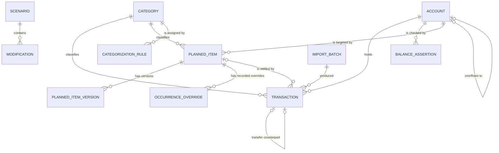

# Domain

This document defines the vocabulary of Demain, the entities and their relationships, the rules that must always hold, and the main algorithms (monthly synthesis, planned items, matching, scenario evaluation). The product context is in [PRODUCT.md](PRODUCT.md), the technical context in [ARCHITECTURE.md](ARCHITECTURE.md).

Entities are described as tables of fields, not as code. Field names are indicative; the final schema will be defined in M1.

## Glossary

| Term | Definition |
| --- | --- |
| **Account** | A place where money is held: checking account, Livret A, Livret Jeune, or any generic account the user creates. Each account has exactly one currency and an optional deposit ceiling. |
| **Transaction** | A real movement of money on one account at one date, usually imported from a bank export. Its kind is expense, income, interest or transfer leg. |
| **Transfer** | A movement between two of the user's own accounts, stored as two linked transactions (one outgoing, one incoming). A transfer into a savings account is a **savings flow**. Transfers are excluded from income and expense statistics. |
| **Deposit ceiling** | An optional maximum balance per account up to which deposits are accepted. Interest is exempt. See [Deposit ceiling and overflow](#deposit-ceiling-and-overflow). |
| **Overflow account** | The account that receives the part of a transfer that does not fit under another account's deposit ceiling. Overflow accounts can be chained. Cycles are not allowed. |
| **Category** | A user-defined label used to group transactions and planned items (Food, Rent, Salary, Subscriptions...). Categories are flat in V1. |
| **Categorization rule** | A user-defined condition on an imported transaction (for example, label contains a text) that assigns a category. |
| **Planned item** | A future movement the user expects and has dated explicitly: either a recurrence (has a repetition rule) or a firm one-off event (no repetition). Its amount and schedule are versioned by effective date. |
| **Occurrence** | One dated instance of a planned item. A one-off planned item has exactly one occurrence; a recurrence has one per repetition. Occurrences are computed on demand, not stored. |
| **Provision** | A planned item that accepts several transactions per occurrence (for example fuel: 90 EUR planned for the month, settled by several fill-ups). |
| **Rolling average** | An amount mode of a planned item: the amount of an occurrence is the average of the item's previous occurrence values. See [Amount of an occurrence](#amount-of-an-occurrence). |
| **Balance assertion** | A real balance the user records for an account at a date (for example, the balance shown on the bank website). It is compared with the computed balance to reveal unexplained gaps. |
| **Real trajectory** | What the app shows by default: real transactions up to today and, beyond today, only planned items that are explicitly dated. It never contains an estimation of spending the user did not plan. |
| **Estimation** | A value derived from the recent average of past spending, standing for spending the user has not planned. Estimations exist only inside simulations. |
| **Constant-pace simulation** | The reference simulation: the real trajectory plus estimated variable spending, with no modification. It answers "what if my life rhythm does not change". |
| **Scenario** | A named, hypothetical set of modifications applied on top of the constant-pace simulation. A scenario never changes real data until it is validated. |
| **Modification** | One change inside a scenario, of one of 8 types (subscription change, one-off purchase, loan, income change, savings goal, interest projection, category budget change, composite life event). |
| **Horizon** | The time range over which a simulation or a scenario comparison is computed (6, 12, 24 months or custom). |
| **Reference currency** | The single currency chosen by the user in which totals, simulations and scenario indicators are expressed. |
| **Exchange rate** | A dated conversion rate between two currencies, stored in the database. Entered by hand by default, optionally fetched from public ECB rates. |
| **Minor unit** | The smallest unit of a currency (the cent for EUR). All amounts are stored as integer counts of minor units and converted to a decimal only for display. |

## Entity model

### Overview

### Account

| Field | Description |
| --- | --- |
| id | Identifier. |
| name | Display name ("Checking", "Livret A"). |
| kind | `checking`, `savings` or `other`. Drives default display and which accounts count as savings. |
| currency | ISO 4217 code. Immutable once transactions exist. |
| opening_date, opening_balance | Starting point of the computed balance, in minor units. |
| deposit_ceiling | Optional, in minor units. Maximum balance up to which deposits are accepted. Null means no ceiling. |
| overflow_account_id | Optional. The account that receives the surplus of a transfer that does not fit under this account's ceiling. Must respect the [protection rules](#protection-of-the-chain). |
| archived | The account is closed: hidden from views but kept for history. See [Archiving an account](#archiving-an-account). |

### Archiving an account

An account that is no longer used is archived, not deleted, so that its history and the balances of past months stay correct.

- **Zero balance.** An account can be archived only when its computed balance is exactly zero. A negative balance blocks the archiving as well. The user empties the account first, typically with a transfer to another account.
- **No more entered movements.** No transaction can be entered on an archived account, and account pickers do not offer it. Its existing transactions can be neither edited nor deleted, since that would move its balance away from zero. A planned item cannot target it, and an account targeted (as account or as destination) by a planned item that is not over cannot be archived until the item is changed. An item is over when it is cancelled, or when it has an end date and the effective date of its last non-cancelled occurrence is before today. An item without end date is never over until it is cancelled or given an end date.
- **Balance assertions are frozen.** No balance assertion can be added, replaced or deleted on an archived account. The ones it already has stay visible, on its own page and on the page listing the assertions of every account, where they are shown as archived with the account. This state is derived from the account: an assertion has no archived field of its own.
- **Imports are the exception.** A transaction imported from the bank has already happened, so it is accepted on an archived account and flagged with a visible warning.
- **History stays.** Past transactions, balances and statistics of an archived account remain in the views that cover their period.

### Transaction

| Field | Description |
| --- | --- |
| id | Identifier. |
| account_id | The account it belongs to. Its currency is the account currency (no per-transaction currency). |
| date | Booking date as given by the bank, a calendar date without time or timezone. There is no separate value date in V1. |
| amount | Signed integer in minor units: negative leaves the account, positive enters it. |
| kind | `expense`, `income`, `interest` or `transfer`. |
| label | Raw label from the bank export, kept unchanged for rules and deduplication. |
| description | Optional user note. |
| payment_mode | Optional: card, transfer, direct debit (kept from the sheet and from imports when available). Both legs of a transfer always carry `transfer`, whether entered in the add-transaction form or created by an import. The add-transaction form preselects the `default_payment_mode` setting (card when it is unset or unreadable), chosen on the Settings page. |
| category_id | Nullable. Null means the transaction is in the **to categorize** queue. Transfers have no category. |
| transfer_counterpart_id | For a transfer leg, the other leg. Null otherwise. |
| planned_item_id, occurrence_date | Set when the transaction settles an occurrence of a planned item (nominal date of that occurrence). Null otherwise: both are null or both are set. They are not part of the import digest, since a link moves no balance and the undo deletes it with the row. |
| category_from_planned_item | True when the category was inherited from a planned item by a match, so that undoing the match can clear it. Any change of category by hand sets it back to false. Default false. |
| import_batch_id | The import that created it, if any. |
| import_fingerprint | Value used to detect duplicates across imports, unique per account, carried by the leg of the account that receives the file (the first leg when the row is split into several transfers). It is the OFX identifier (`FITID`) when present, otherwise the content key: built from date, amount and normalized label (case and spacing ignored) plus the rank of the row among identical rows of the file, so that two genuine identical movements both survive and are both recognized the next time. Without a bank identifier, a movement identical to an earlier one that first appears in an export starting between them (same day, same amount, same label) cannot be told from the earlier one and is ignored as a duplicate: the preview shows the number of duplicates so that it can be checked. |
| import_content_key | The content key of every imported transaction, kept even when the bank gave an identifier. It lets the same movement exported again in the other format (CSV after OFX, OFX after CSV) be recognized. Bank identifiers stay authoritative between themselves: two OFX movements with the same content but other identifiers are both kept. |

### Category and categorization rule

| Category field | Description |
| --- | --- |
| id, name | Identifier and display name (translatable labels for default categories). |
| icon | One key of a closed set of 20 icons (`CATEGORY_ICONS`), always present: a category without a chosen icon gets the default `tag`, which is also what the categories that existed before icons received. The set is closed so that the app draws it itself: no free text and no image. |
| archived | Hidden from pickers but kept for history. |

- **Unique names.** Category names are unique regardless of case, archived categories included, so that two homonyms never coexist in the history or in a rule.
- **Archiving keeps the history.** An archived category stays on the transactions that already carry it and in the views of their period, but it is never newly assigned and does not appear in pickers. It can be reactivated: it is then offered again in the pickers and the rules that point to it apply again.
- **To-categorize queue.** An entered transaction without a category waits in the queue. A transfer has no category and is never in the queue.
- **Categorizing moves no balance.** It is allowed on a transaction of an archived account, unlike editing or deleting it.

| Rule field | Description |
| --- | --- |
| id | Identifier. |
| condition | Field (label in V1), operator (contains, starts with, equals) and value. Case-insensitive. |
| account_id | Optional restriction to one account. |
| category_id | Category assigned on match. |
| priority | Order of evaluation; the first matching rule wins. |

- **Rules apply to imports only.** A rule never changes a transaction already recorded, and creating or deleting a rule recategorizes nothing.
- **Archived categories.** A rule pointing to an archived category is kept but skipped, so the transaction goes to the to-categorize queue.
- **Order.** A new rule goes last; the user moves rules up or down, which swaps their priorities.

### Planned item and versions

| Planned item field | Description |
| --- | --- |
| id | Identifier. |
| name | "Rent", "Salary", "Music streaming", "Car insurance", "Fuel". |
| account_id, category_id | Target account and category. |
| kind | `expense`, `income`, `interest` or `transfer` (a planned savings transfer also names the destination account). |
| start_date | Lower bound of the nominal dates: the first occurrence is the first date of the rule on or after it. For a one-off item, its only date. |
| end_date | Optional last date for a recurrence. |
| accepts_multiple_transactions | True for a provision (several transactions settle one occurrence). Default false. A provision needs a repetition: it is refused on a one-off event, and on a transfer. |
| provision_label_filter | Optional text for a provision: only transactions whose label contains it are linked automatically (for example `carburant`). |
| match_window_days | Default 5. |
| match_amount_tolerance_bp | Tolerance of the amount when matching, stored in basis points so that no percentage is ever a float: 500 is 5% (the default), from 0 to 10000. |
| cancelled | A cancelled planned item produces no future occurrence. An item that no transaction references (no transaction has its `planned_item_id`, with or without an occurrence date) can instead be deleted, active or cancelled: its overrides, its versions and the item go in one database transaction, and the check runs inside it. An item that a transaction references is kept for the history (invariant 5) and can only be cancelled. |
| source_scenario_id | Set when the item was created by validating a scenario. |

A planned item has one or more **versions**. A version applies from its `effective_from` date until the next version:

| Version field | Description |
| --- | --- |
| planned_item_id | Owner. |
| effective_from | Date from which this version applies. |
| repetition | Null for a one-off event. Otherwise one of: monthly on day N, monthly on last day, yearly, every N months, quarterly, every N weeks. Stored as `repetition_kind` (`monthly_on_day`, `monthly_on_last_day`, `every_n_months`, `quarterly`, `yearly`, `every_n_weeks`, null for a one-off event) and `repetition_value` (the day, the months or the weeks). |
| business_day_rule | Optional: none, previous business day, next business day. |
| amount | Signed integer in minor units: the fixed amount, or the starting estimate when the mode is rolling average. |
| amount_mode | `fixed` or `rolling_average`. |
| average_window | Number of previous occurrences averaged: 3 (default), 6 or 12 and nothing else. |

Examples:

- A salary has a version with amount 1143.88 and a later version with amount 1171.47, effective from the date of the raise. Occurrences before that date use 1143.88, occurrences on or after use 1171.47.
- A rent paid on the 5th moves to the 1st from March: a new version effective from March with the same amount and a new repetition. Occurrences before March keep the 5th. This is how "change all future dates of a subscription at once" works.

Rules of a new version, as implemented (`validatePlannedItemVersion` in `src/domain/planned-item.ts`, used by `addPlannedItemVersion` in `src/ledger/planned-items.ts` and by the "Change from a date" section of the edit page):

- The effective date is a calendar date between the start date and, when there is one, the end date.
- The amount is nonzero and has the sign of the kind of the item.
- A repetition cannot be added to a one-off item: its versions all stay one-off events.
- A new version inherits the amount mode and the average window of the version in effect on its effective date (the last version whose date is on or before it, else the first). The business-day rule is inherited the same way when the form does not give one.
- A cancelled item takes no new version, nor does an item whose account is archived.
- The end date can be set or cleared on a repeating item (the "End date" section of the edit page), and not before the start date. A one-off item has no end date. It is inclusive and cannot be earlier than the nominal date of the last occurrence that is skipped, modified or linked to a transaction (#204, see Occurrence override): the message gives that nominal date as the earliest end date allowed. Clearing the end date is always allowed.
- Cancelling an item (the "Cancel" section) stops all its occurrences after today. It is idempotent and nothing is written when a validation refuses.

Decisions of the owner on versions, 19 Nov 2026, issue #161 (numbered as in that issue, not as in #157):

- Q1, an effective date in the past is allowed, but refused when an occurrence on or after it is settled or has an override: history is never rewritten. The message gives the earliest allowed date, the day after the latest settled or overridden nominal date. The linked transactions (as nominal dates) and the overrides are arguments of the pure validation, since `src/domain` reads neither the database nor the clock.
- Q2, a version effective on the start date replaces the first version, as long as no occurrence is settled.
- Q3, a version on a date that already has one replaces it, and the interface says so (as for a balance assertion of the same day).

### Occurrence override

Occurrences are generated on the fly (see [invariants](#invariants)). Only the occurrences that the user changed individually are recorded:

| Field | Description |
| --- | --- |
| planned_item_id | Owner. |
| nominal_date | The date computed by the repetition rule, which identifies the occurrence. |
| status | `cancelled` (a single occurrence skipped without cancelling the whole item) or `modified`. |
| override_date | For `modified`: the date to use instead (a merchant delays one payment). Optional. |
| override_amount | For `modified`: the amount to use instead for this occurrence only. Optional. |

The user creates overrides from the "Change" button of a planned row, in the monthly line view and in the day details of the calendar grid, on a single occurrence, without touching the rest of the item. Validation (`validateOccurrenceOverride` and `validateOccurrenceOverrideRemoval` in `src/domain/planned-item.ts`, applied by `saveOccurrenceOverride` and `deleteOccurrenceOverride` in `src/ledger/planned-items.ts`):

- The item is not cancelled, its account is not archived, and the occurrence is not linked to a transaction (Q1 below). These three checks apply to saving and to restoring.
- The nominal date is a calendar date that the schedule produces. The business-day rule plays no part: the nominal date is the identity of the occurrence, not the date it is shown on.
- A skip (`cancelled`) stores no date and no amount, whatever the form holds.
- A `modified` override needs a new date, a new amount, or both. The date is a calendar date; the amount is not zero and has the sign of the kind of the item (typed without a sign, signed on the server).
- Saving again on the same nominal date replaces the override, so a skipped occurrence given a date or an amount is `modified` again.
- Restoring deletes the override, and the occurrence takes back its computed date and amount. Restoring an occurrence without override changes nothing and is not refused.

Decisions of the owner on occurrence overrides (`src/domain/planned-item.ts`), 19 Nov 2026, numbered as in issue #174:

- Q1, refused: an occurrence settled by a transaction has no "Change" button and cannot be changed, moved, skipped or restored. It is unlinked first (#168).
  - Confirmed by the owner on 25 Nov 2026: an occurrence counts as settled as soon as at least one transaction is linked on its nominal date, a partial provision included, the same notion a new version uses (see Planned item and versions).
- Q2, allowed: the override date may fall outside the span of its version or after the end date of the item.

Decision of the owner on the end date, 25 Nov 2026, issue #204 (option A): an end date earlier than the nominal date of the last occurrence that has an override (skipped or modified) or a linked transaction is refused, since the schedule would stop producing that occurrence and its override or link would no longer show. An end date on that nominal date is accepted, the end date being inclusive. Only the nominal date counts: an occurrence moved after the end date does not block it (Q2 above). To end earlier, the user restores or unlinks that occurrence first. Clearing the end date and cancelling the whole item are not affected. The check is in `validatePlannedItemEndDate` (`src/domain/planned-item.ts`), which receives the linked nominal dates and the overrides, read by `setPlannedItemEnd` inside its transaction.

### Occurrence status

Statuses are derived, never stored:

| Status | Condition |
| --- | --- |
| `planned` | Not cancelled, no transaction linked, matching window not yet passed. |
| `partial` | Provision only: some transactions are linked, the remaining amount is above zero, period not yet passed. |
| `confirmed` | At least one transaction is linked and the occurrence is settled: for a regular item as soon as its transaction is linked, for a provision when the linked sum reaches the amount or when its period has passed. |
| `overdue` | No transaction linked and matching window passed: today is strictly after the date plus `match_window_days`, the date being the business-day-adjusted or overridden one. For a provision, no transaction linked and its period passed (today after its last day). |
| `cancelled` | The item or this single occurrence is cancelled, and no transaction is linked: a settled occurrence stays `confirmed` (confirmed wins). |

Decisions of the owner on occurrence status (`src/domain/occurrence-resolution.ts`), 19 Nov 2026, numbered as in issue #162:

- Q1, an occurrence settled by a transaction stays `confirmed` even if the item or the occurrence is cancelled afterwards.
- Q2, the window bound is inclusive: an occurrence is `planned` up to and including the last day of its window (date plus `match_window_days`) and `overdue` the day after.
- Q3, a link to a nominal date that the schedule no longer produces is ignored for the statuses and reported apart by `findOrphanLinks(item, links, today)`, so that a page can show it. The signature of `resolveOccurrences` does not change. A link dated after the cancellation of an item is reported too, since a cancelled item produces nothing after today. A link on a nominal date the schedule produces but that lies outside the requested range is neither attached nor reported.

Links attach to an occurrence by its nominal date. A settled occurrence of a cancelled item keeps `isCancelled: true` from generation: consumers read `status`, not `isCancelled`. `resolveOccurrences(item, links, range, today)` resolves the occurrences in one pass in nominal-date order. A second link on a regular occurrence keeps it `confirmed` and both links are listed (invariant 5): nothing throws. Provisions (the `partial` status, the remaining amount and the period) are resolved in the same pass, see Provisions below.

### Balance assertion

| Field | Description |
| --- | --- |
| account_id, date | Account and date of the observed balance (end of day). |
| amount | Real balance in minor units, as shown by the bank. |
| note | Optional. |

The app displays `computed balance at date - asserted amount` as the **unexplained gap**.

An import can record one at the end date of the file (the date of its last movement), and it replaces an assertion of the same day as any other assertion.

There is at most one assertion per account and date: recording the same day again replaces the earlier amount and note. The date cannot be before the opening date of the account, since the computed balance starts there. Recording a day that already has an assertion is announced to the user as a replacement. An assertion can be deleted while its account is active. The computed balance at a date is the opening balance plus every transaction of the account dated on or before that day.

The real account balances of the sheet's Summary tab become balance assertions through the same rules (a day that already has one is replaced, and announced as such). A Summary month gives one assertion, dated the **last day of the month** (leap years included), on the account chosen by the user. A month the sheet leaves without a balance creates nothing and is named, it is not an error. A month is **refused** when the account is archived, when the month ended before the opening date of the account, or when its last day is after today (the current month is not over, so its real balance is not known yet). Everything accepted is recorded in one transaction, all or nothing, after a preview that lists what would be created, replaced and refused. When two rows name the same month, the first is kept and the other is reported.

The `/balances/summary` screen does this in two steps: the file, the account (active accounts only) and an optional year give a preview, a table that says in text, for each month, whether its balance will be created, will replace the balance of that day (with the previous amount), is refused (with the reason) or is nothing to record; then an explicit second action records everything. The same screen compares the Summary with the history already stored in Demain, month by month (net, savings, cumulative savings, cumulative account, real savings balance), with the month-by-month comparison of the sheet figures. Only the months from the first to the last Summary month that is over are compared (the others are named), the savings balance is the sum of the balances of the accounts of kind savings, and a difference is shown as the two amounts and the signed gap (Demain minus the Summary), never by color alone. Tolerance is zero.

### Scenario and modification

| Scenario field | Description |
| --- | --- |
| id, name | Identifier and display name. |
| status | `draft` or `validated`. |
| created_at | When the scenario was created. |
| validated_at | Date of validation, if any. |

The constant-pace simulation is not a stored scenario: it is the evaluation with an empty list of modifications, always available.

| Modification field | Description |
| --- | --- |
| id, scenario_id | Identifier and owner. |
| type | One of the 8 types listed in [Scenario evaluation](#scenario-evaluation-pipeline). |
| position | Order of the modification in its list: the modifications of the scenario, or the children of its composite ([D5](#scenario-evaluation-pipeline)). |
| label | 1 to 80 characters: the name of the planned item it creates, and its name in the tables ([D7](#inputs-of-each-modification-type)). |
| parameters | Type-specific parameters, validated by a schema per type. |
| parent_id | For a composite life event, the group modification that contains it. |

| Estimate override field | Description |
| --- | --- |
| account_id | The account of the estimate line. |
| category_id | The category of the line, or null for the uncategorized line of the account. |
| monthly_amount | The monthly amount set by the user for the line, in minor units. |

Estimate overrides are simulation settings shared by every simulation, stored once ([D3](#estimated-variable-spending)).

**Life of a scenario (D14, owner, 26 Nov 2026).** A draft scenario can be renamed, edited, duplicated, deleted, compared and validated. A validated scenario is read-only: it shows its modifications, its validation date and the planned items it created; it can be duplicated into a new draft named `<name> (copy)` and deleted. Deleting a scenario keeps the planned items it created and sets their `source_scenario_id` to null. A scenario name has 1 to 80 characters once trimmed.

### Currency and exchange rate

| Settings field | Description |
| --- | --- |
| reference_currency | ISO 4217 code used for totals and simulations. |
| ecb_fetch_enabled | False by default. |

| Exchange rate field | Description |
| --- | --- |
| date | Date of validity. |
| base, quote | Currency pair. |
| rate | Exact value stored as an integer scaled by 10^8 (1.0821 is 108210000), never a binary float. Positive, at most 8 decimals. |
| source | `manual` or `ecb`. |

To convert an amount at a date, the app uses the most recent rate on or before that date, stored in either direction of the pair (a EUR to USD rate also converts USD to EUR). One rate per pair and day: entering the same day again replaces it, except that a rate fetched from the ECB never replaces one entered by hand. Future simulations use the most recent known rate.

### Import batch

| Field | Description |
| --- | --- |
| id | Identifier. |
| account_id | Target account. |
| format | `csv` or `ofx`. |
| imported_at, file_name | Traceability. |
| mapping | For CSV: the column mapping used, reusable for the next import from the same bank. |

## Invariants

These rules must hold at all times and are the first candidates for unit tests.

1. **Amounts are integers in minor units.** No floating-point value is ever stored or used for money arithmetic, except the annuity formula of a loan payment in a simulation, rounded once to the minor unit ([D4, rule 3](#rounding-of-the-engine)). Text amounts ("1 143,88 €") are parsed to integer minor units by string handling, never through a float, and converted back to a decimal string only for display and export. The number of decimals comes from the currency (2 for EUR). Division (averages, percentages, interest, loan payments) rounds explicitly to the minor unit at a documented step.
2. **A transaction's currency is its account's currency.** Cross-currency views convert to the reference currency at read time using stored rates.
3. **A transfer is exactly two linked transactions** of opposite sign, on two different accounts, each pointing to the other. Deleting one deletes both. Transfers are excluded from income and expense statistics and from category statistics; transfers into savings accounts are reported as savings flows.
4. **Occurrences are generated, not stored.** The list of occurrences for any horizon is a pure function of the planned item (versions, business-day rule), its recorded overrides and its linked transactions. Changing a schedule from a date changes all later non-settled occurrences at once.
5. **A transaction settles at most one occurrence**, and an occurrence is settled by at most one transaction, except for a provision, which accepts several. The outgoing legs of one imported savings row split along the overflow chain settle one planned transfer together and all carry its link: they count as one settlement.
6. **The nominal rule is kept.** Matching never alters a planned item's rule; the real date and amount come from the matched transactions.
7. **Real data is never changed by a scenario** until the scenario is validated, and validation only creates or modifies planned items, never transactions.
8. **The computed balance of an account** at a date equals its opening balance plus the sum of its transactions up to and including that date.
9. **The real trajectory contains no estimation.** Beyond today it contains only explicitly dated planned items (whose amount may follow a rolling average chosen by the user for that item). Estimated variable spending exists only in simulations.
10. **The deposit ceiling holds for entered data.** See [Deposit ceiling and overflow](#deposit-ceiling-and-overflow).
11. **Overflow chains are acyclic**, stay within one currency, and are never saved with an archived account, or an account that is not a savings account, as target. An archived account keeps the link it had: it holds nothing and receives nothing, so the link is never evaluated.
12. **An archived account has a zero balance** and receives no entered transaction. See [Archiving an account](#archiving-an-account).

## Deposit ceiling and overflow

A ceiling limits the balance an account may reach through deposits. An account may also name an **overflow account**, which receives what does not fit. Overflow accounts can be chained: an account overflows to a second one, which overflows to a third, and so on.

### Rules

- The ceiling applies to the **balance** and to **deposits**: an incoming transfer, or an income entered on the account. **Interest is always accepted** and may bring the balance above the ceiling. Withdrawals lower the balance and free room.
- The **room** of an account is its ceiling minus its balance, never below zero.
- A transfer into an account that is full, or that would become full, is **split along the chain**: the part that fits goes to the destination account, the surplus goes to its overflow account whose own room is checked the same way, and so on. What fits nowhere **stays in the source account**: it is not transferred, and it is reported as unplaced.
- For a transfer **entered by hand**, the app shows the split before recording and offers: cancel; **deposit only the room** (the surplus is simply not transferred, as if the user had only typed that amount); or deposit the room and send the surplus to **an account chosen by the user** (the overflow account is pre-selected when there is one, and the same room check applies to the chosen account).
- For a **planned occurrence** and for a **simulated** transfer (including a savings goal), the split follows the overflow chain **automatically**: the occurrence does not exist yet, so nothing is asked. The result is shown in the calendar and in the simulation, with any unplaced surplus flagged.
- The **savings rows of an imported file** are split the same way, one after the other in date order, from the running balances of the accounts. What fits nowhere blocks the whole file, unless the user gives the account at the end of the chain an overflow account: the review shows the amount that does not fit, asks which account takes it, and the account chosen (or created, in the currency of the savings account) becomes that overflow account for good. The choice is only remembered in the review: the link, and the account when it is new, are written with the file, in the same transaction, and a refused or abandoned import writes neither. The review only asks when the account has a ceiling and no overflow account, only offers active savings accounts of the currency, never the account that receives the file, and the usual rules apply to the choice (no cycle, same currency, savings kind, no archived target). A new question follows if the chosen account is full in turn and has no overflow account.
- An **income** that would exceed a ceiling is not routed, since the money has really arrived there. It is accepted with a warning.
- A transaction **imported from the bank is never changed**, since the movement already happened. It is accepted and flagged with a visible warning ("exceeds the declared ceiling: check it, or mark it as interest").

### Protection of the chain

The chain comes from user input, so it is never trusted:

- **No cycle.** Saving an overflow account is refused when following the chain from the chosen target would come back to the account itself (the account itself, A to B to A, or any longer loop). The check runs on the server at every save and on every load of external data, including a restored backup or a JSON import.
- **Same currency.** An overflow account must have the same currency as the account that overflows to it, since a transfer between currencies would need a conversion that V1 does not model. For the same reason, the currency of an account cannot change while an active account uses it as its overflow account.
- **Savings only.** An overflow account must be an active account of kind savings: a checking account or an account of another kind is refused at every save and every load of external data, and the choice lists of the account screens and of the import review only offer such accounts.
- **Not archived.** An archived account cannot be chosen as an overflow account. An account that is the overflow account of an active account cannot be archived or deleted until that reference is changed. An archived account that still points to another account is ignored as a referrer: it cannot be edited any more, so counting it would lock its target for good.
- **Defensive evaluation.** Even if a cycle were present in stored data, evaluating a chain keeps the accounts already visited and stops at the first repeat. It reports the configuration as invalid and places nothing, so a computation can never loop.

### Examples

- A Livret Jeune with a ceiling of 1 600.00 EUR, a balance of 1 550.00 and the Livret A as overflow account. A transfer of 200.00 from checking is split into 50.00 to the Livret Jeune and 150.00 to the Livret A.
- Same Livret Jeune, and the Livret A has a ceiling of 22 950.00 EUR and a balance of 22 900.00. The same transfer is split into 50.00, 50.00 and 100.00 that stays in checking, reported as unplaced.

## Monthly synthesis

The sheet's monthly tabs become filters on a single list of transactions. For a given month and account set, Demain computes three views.

| View | Definition |
| --- | --- |
| **Net of the month** | Sum of `income` and `interest` transactions minus sum of `expense` transactions in the month. Transfers are excluded. This is the sheet's "Final balance". |
| **Savings of the month** | Sum of transfers from non-savings accounts into savings accounts in the month, minus transfers back out. |
| **End-of-month balances** | Computed balance of each account on the last day of the month, plus a total converted to the reference currency. |

How the figures are bounded:

- **Series.** It starts at the oldest month among the opening dates of the accounts and the dates of the transactions, and runs without gaps up to the month asked for. A month without movement is kept, with zero flows.
- **Accounts.** An account counts from the month of its opening date, with its opening balance and its transactions up to the last day of each month. Archived accounts stay in the months their history covers.
- **Savings legs.** Only the legs of a transfer on a savings account count, and only when the other end is not a savings account: a transfer between two savings accounts (an overflow, for instance) is neither a deposit nor a withdrawal.
- **Currencies.** Net, savings and totals are in the reference currency. Accounts in another currency are shown in their own currency. Their end-of-month balance enters the total converted at the rate in force on the last day of the month, and each net or savings flow is converted at the rate in force on its own date, each rounded to the minor unit on its own. A balance or a flow with no rate on or before its date is left out of the figures and its currency is reported for the month.

In the sheet, the Summary tab also tracked derived cumulative figures. Demain can show them as well:

- **Cumulative savings** = sum of savings of the month since the start.
- **Cumulative account** = sum of net of the month since the start minus cumulative savings. It is the change of the checking account since the start, assuming every flow goes through checking. In Demain, the checking end-of-month balance equals its opening balance plus this value, minus any unexplained gap.

### Worked example from the sheet

Figures from the sheet's Summary tab (EUR):

| Month | Net of the month (sheet "Final balance") | Savings of the month | Cumulative savings | Cumulative account |
| --- | ---: | ---: | ---: | ---: |
| January | 576.14 | 573.16 | 573.16 | 576.14 - 573.16 = **2.98** |
| February | 806.07 | 650.00 | 573.16 + 650.00 = **1223.16** | (576.14 + 806.07) - 1223.16 = 1382.21 - 1223.16 = **159.05** |

In minor units, January is `57614 - 57316 = 298` and February is `(57614 + 80607) - 122316 = 15905`. Once the history is imported, Demain must reproduce these numbers exactly; this is an acceptance test of M1 (see [ROADMAP.md](ROADMAP.md#m1-ledger)).

The sheet also had a real account balance and a real savings balance entered by hand each month. These become **balance assertions** at the last day of each month, and any difference with the computed balance appears as an unexplained gap instead of being silently overwritten.

### The real chart

The main diagram of the app, and the one the sheet already had: for each month end, two curves.

- **Checking**: total of the checking accounts at the end of the month.
- **Savings**: total of the savings accounts at the end of the month.

Both are in the reference currency and are computed from real transactions only, from the first month to the last complete month. Beyond that, the chart continues with explicitly dated planned items (the projection of [Daily balance of the real trajectory](#daily-balance-of-the-real-trajectory), read at each month end), drawn dashed and with a distinct marker so that real and planned values are never confused (not by color alone). No estimation is ever drawn. Every chart has an equivalent data table.

Decisions of the owner on the planned part, numbered as in issue #171:

- Q1, the current month: it is the first planned month, drawn dashed. The last real point stays the last complete month. The end of the current month is the real balance so far plus what is still planned, so nothing is estimated.
- Horizon: chosen in the browser among 3, 6 and 12 months counted from the current month. The server reads 12 months once and the browser slices them, so changing the horizon costs no request. The chart and its data table always show the same months.
- Lowest planned balance: the lowest planned month end of the checking series, over the planned months only. A lower real month never counts, since the indicator is about what is still ahead.
- Hidden when empty: the planned part is not drawn when no planned item changes any month end of the checking or savings series compared with the real trajectory without planned items.

## Planned items and recurrence

### Generating occurrences

For a requested horizon `[from, to]`:

1. Enumerate nominal dates from `start_date`, which is a lower bound (the first date is the first one of the rule on or after it). Each date follows the repetition rule of the version in effect at that point: dates before a version's `effective_from` follow the previous version, dates from `effective_from` follow the new one. Stop at `end_date` or `to`.
   - "Monthly on day N" uses the last day of the month when the month is shorter than N (day 31 in February gives the 28th or 29th).
   - "Monthly on last day" always uses the last day.
   - Each monthly date is computed from its own month, never by moving the previous date by one month, so day 31 returns to the 31st after a short month.
   - "Every N months" and "quarterly" keep the day of `start_date`, every N (or 3) months from its month, clamped per month like "monthly on day N". "Quarterly" is its own kind (a shortcut of the form) but gives the same dates as "every N months" with 3. "Yearly" keeps the day and month of `start_date`.
   - "Every N weeks" is `start_date` plus 7 x N x k days.
   - Decisions of the owner, 19 Nov 2026:
     - Q1, yearly from 29 February: 28 February in years without a 29 February, the same clamp as "monthly on day N" (the date comes back to the 29th in leap years).
     - Q2, quarterly: every 3 months from the start date, not the calendar quarters. It stays its own kind, as a shortcut of the form.
     - Q3, a start date that is not on the rule: not refused. It is a lower bound, so "monthly on day 5" from 20 January gives 5 February first.
2. Apply the business-day rule if set (move a date falling on a weekend to the previous or next weekday). Weekends only: public holidays are not handled in V1. The nominal date is still the identity of the occurrence.
3. Apply recorded overrides, found by nominal date (an override for a date the rule does not produce is ignored): a `cancelled` occurrence is kept with `isCancelled: true` (the projection and the matching drop it, the calendar can show it), a `modified` one takes its `override_date` and/or `override_amount` (with neither, it has no effect).
4. Compute the amount of each occurrence (next section).
5. Link settling transactions and derive the status (see [Occurrence status](#occurrence-status)).

Decisions of the owner on occurrence generation (`src/domain/occurrences.ts`), 19 Nov 2026, numbered as in issue #157:

- Q1, a cancelled occurrence is kept with `isCancelled: true`, not removed (step 3).
- Q2, the effective date (business-day rule, then override date) decides whether an occurrence is in the requested range. The nominal date stays its identity.
- Q3, a version that changes the repetition restarts its series from its `effective_from`. A version that only changes the amount or the amount mode continues the phase of the previous series.
- Q4, a cancelled planned item produces nothing after today. Its earlier occurrences are flagged cancelled, except a settled one, which stays confirmed. Generation alone cannot know which one is settled and flags them all: keeping the settled ones confirmed is done by the status derivation (#162).
- Q5, the first version is always effective from the start date.

There is no maximum horizon: the computation is bounded only by what is displayed.

### Amount of an occurrence

Two modes, chosen per planned item version. **Fixed is the default.** The rolling average is an option the user turns on for a given item, and only then does it apply.

**Fixed.** The occurrence amount is the `amount` of the version in effect on its nominal date.

**Rolling average.** The `amount` of the version is only the starting estimate (typical for a new item, entered by hand). Then:

1. The **reference value** of a previous occurrence is the sum of its linked transactions when it is settled, or its own estimated amount when it is still in the future.
2. The **estimated amount** of an occurrence is the average of the reference values of the previous `average_window` occurrences (fewer when fewer exist). When there is no previous value, it is the starting estimate.
3. Occurrences that were **cancelled**, or that are **overdue** without a linked transaction, are skipped: they are not payments.
4. A new version effective from a date **restarts** the average: occurrences before that date are no longer part of the window, and the starting estimate of the new version applies again.
5. A manual amount override on one future occurrence (see [Occurrence override](#occurrence-override)) is used for that occurrence only and does **not** feed the average of the next ones. Real payments do.
6. The average is computed in integer minor units and rounded to the nearest minor unit (ties away from zero) at every step.

Example with a window of 3 and a starting estimate of 90:

| Moment | Occurrence 1 | Occurrence 2 | Occurrence 3 | Occurrence 4 |
| --- | ---: | ---: | ---: | ---: |
| Nothing paid yet | 90 (starting estimate) | 90 (value of 1) | 90 (average of 1 and 2) | 90 (average of 1, 2 and 3) |
| Occurrence 1 paid 100 | 100 (real) | 100 | 100 | 100 |
| Occurrences 2 and 3 paid 110 and 120 | 100 (real) | 110 (real) | 120 (real) | 110 (average of 100, 110, 120) |

Because the window feeds on its own estimates, the long-term estimate converges to a weighted average that favors recent values rather than to the simple average of the last real values. With real values 80, 90 and 100, the next estimates are 90.00, 93.33, 94.44, 92.59, 93.45 (rounded at every step) and so on, converging to (80 + 2 x 90 + 3 x 100) / 6 = 93.33, whereas the simple average of the last three real values is 90.

### Provisions (several transactions for one occurrence)

A provision is a planned item with `accepts_multiple_transactions`, such as fuel planned at 90 EUR per month on the 15th, settled in reality by several fill-ups.

- **Period of an occurrence** (`provisionPeriod`, `src/domain/provision.ts`), both bounds inclusive. For a monthly repetition (`monthly_on_day`, `monthly_on_last_day`, and `every_n_months` with 1), the calendar month of its nominal date. For any other repetition, from the day after the previous nominal date up to its nominal date. The first occurrence has no previous date: its period has the same length as the others, as if an occurrence existed one repetition earlier. The period of a resolved occurrence is exposed as `ResolvedOccurrence.period` (null for a regular item).
- **Matching window and tolerance** do not apply to a provision: the period is what bounds its transactions, and no amount is compared. "The period has passed" means that today is after its last day.
- **Linking.** Transactions on the same account, with the item's category, dated within the period and, when the provision has a label filter, whose label contains the filter text, are candidates of the occurrence (`isProvisionCandidate`; a transfer never is). The label test is exactly the "contains" operator of the categorization rules (`labelContains`: trimmed, case-insensitive, accents not folded), with no second logic. The filter matters when a category mixes several things (a car category holding fuel, insurance and tolls). Each linked transaction can be unlinked, and any other transaction of the period can be linked, by hand.
- **Remaining amount.** `max(0, amount - sum of linked transactions)`, never past zero and keeping the sign of the amount. A linked transaction of the opposite sign covers nothing. Only the remaining amount is counted at the occurrence date in the real trajectory.
- **Statuses.** `planned` without link, `partial` while the remaining amount is above zero, `confirmed` once the linked sum reaches the amount. A cancelled provision with links follows these rules, without links it stays `cancelled`.
- **After the period.** Once the period has passed (today after its last day), the remaining amount is 0: any leftover provision disappears (the occurrence is `confirmed` if at least one transaction was linked, `overdue` otherwise). Spending above the amount is simply real spending.
- The linked sum is the reference value of a confirmed provision for a rolling average.

Decisions of the owner on provisions, 19 Nov 2026, numbered as in issue #164:

- Q1, the first period of a non-monthly provision has the same length as the others.
- Q2, `every_n_months` with 1 counts as monthly, like `monthly_on_day` and `monthly_on_last_day`.
- Q3, label matching is the "contains" operator of the categorization rules, with no second logic.

### Matching planned vs actual

Runs at each import (see Importing files), for each new non-transfer transaction (and for transfer legs against planned transfers). Regular items:

1. **Candidates.** Occurrences whose status is `planned` or `overdue` (not yet settled or cancelled), on the same account, whose nominal (or business-day adjusted, or overridden) date is within `match_window_days` (default 5) of the transaction date, and whose expected amount is within `match_amount_tolerance` (default 5%) of the transaction amount, with the same sign.
2. **Decision.**
   - Exactly one candidate occurrence, and that occurrence is the only candidate for exactly this transaction: the match is **confirmed automatically**, and shown in the import summary where it can be undone.
   - Several candidates on either side (two similar subscriptions, two transactions of the same amount in the window): the possible pairs are **proposed for validation**. Nothing is matched silently.
   - No candidate: the transaction stays unmatched and follows the normal categorization flow.
3. **Effect of a confirmation.** The transaction is linked to the occurrence. If the planned item has a category and the transaction has none, the transaction inherits it.
   - **Undoing a match** clears the link. The category is cleared only when it came from the match: `transactions.category_from_planned_item` is set to true when it is inherited, and back to false whenever the category is changed by hand (categorize form, edit page, to-categorize queue). A category chosen by hand stays.
4. **Unmatched occurrences** stay `planned` until the window has passed, then become `overdue`. The user can then match by hand, cancel the occurrence, or leave it.

The window and tolerance of regular items are configurable per planned item, since some direct debits move by several days and some bills vary more than 5%. The window and the tolerance bounds are inclusive. The tolerance is relative to the transaction amount and tested with integer arithmetic only, without a division (`isWithinTolerance`): the expected amount is within tolerance when `|expected - actual| * 10000 <= basisPoints * |actual|`. The sign must be the same, and a tolerance of 0 basis points means equal amounts.

Decisions of the owner on matching, 19 Nov 2026:

- Q1, the sign is enough: the kind of the transaction need not match the kind of the planned item (an interest can settle an income item).
- Q2, a transaction that is a candidate for a provision and for a regular occurrence goes to the proposed group. Nothing is applied silently.
- Q3, a transaction that fits two provisions goes to the proposed group.

**Linking by hand.** The user can link an unmatched transaction to an occurrence, and unlink a transaction, from the edit page of the transaction (`listLinkCandidates`, `linkByHand` and `unlinkByHand` in `src/ledger/planned-matching.ts`, which wrap `linkTransactionToOccurrence` and `unlinkTransaction`). This is the usual way to settle a transaction entered by hand, since matching runs after imports only. The calendar also links from the other side: the page "Link a transaction" of an occurrence lists the unlinked transactions it can take (`listOccurrenceLinkCandidates`), and the choice goes through `linkByHand` and its checks.

- The candidates of a manual link are every occurrence of a non-cancelled planned item on the same account as the transaction, of the same sign, that is neither settled nor cancelled, sorted by the distance between the occurrence date and the transaction date (ties: the earlier date, then the planned item). No window and no amount tolerance apply: the owner knows better. A provision is unsettled while it is still planned, partial, or overdue with nothing linked; a provision with linked transactions whose period has ended is settled, its leftover dropped. A transfer and an already linked transaction have no candidate (decision Q2 of issue #168, 19 Nov 2026).
- A manual link never changes the category of the transaction (unlike an automatic match, which gives the category of the item to a transaction without one) and never changes the planned item (invariant 6). A regular occurrence refuses a second transaction (invariant 5), checked on the server at each write.
- Unlinking a manual link leaves the category alone, since it was not inherited. Unlinking an automatic match clears the category only when it came from the match, as described above.
- **From an occurrence.** The page "Link a transaction" lists the unlinked, non-transfer transactions of the account of the item only, with the sign of what the occurrence expects, newest first; the server refuses any other account. Its date range starts as the matching window of the item around the occurrence (the period of a provision), and the user can widen it or clear a bound (owner, 25 Nov 2026). For an occurrence more than a year after today, the range never starts more than 366 days before it, the horizon within which `linkByHand` finds the occurrences of a transaction. A planned transfer has no such page, since a transfer is never linked by hand.

**Mark as paid.** For a payment that no file has brought yet (or an account that is never imported), the user marks a due occurrence as paid, received or transferred, and Demain records the real transaction and links it, in one database transaction (`markOccurrencePaid` in `src/ledger/planned-matching.ts`; issue #178, owner answers of 19 and 25 Nov 2026).

- Only an open occurrence takes it: planned, partial or overdue, of an item that is not cancelled, on accounts that are not archived. A settled, cancelled or unknown occurrence is refused, checked inside the same database transaction as the write.
- The transaction follows the rules of one entered by hand: the account and the kind of the item (an expense is negative, an income or an interest positive), the item name as label, the default payment mode of the settings, no import batch. The date and the amount are the planned ones (the remaining amount of a partial provision); the "To pay" page lets the user correct them first, the calendar records them as they are. The category of the item is inherited as by an automatic match (`category_from_planned_item` set), so that unlinking clears it.
- An income above the deposit ceiling of its account is recorded with a warning that says by how much, as when it is entered by hand.
- A regular occurrence becomes confirmed; a provision takes one more payment each time and stays partial until its remaining amount is zero (invariant 5). The planned item never changes (invariant 6).
- A planned transfer follows the manual transfer flow (`recordManualTransfer`): the split is shown before recording, and when the destination is above its ceiling nothing is written until the user decides what becomes of the surplus. The legs carry the payment mode "transfer", and every outgoing leg settles the occurrence, as for an imported row.
- **Due occurrences** (`dueOccurrences` in `src/domain/planned-matching.ts`, `listDueOccurrences` in the ledger): the open occurrences whose effective date is today or earlier are due, oldest first; those of the next `DUE_SOON_DAYS` (7) days follow apart. Items of an archived account and cancelled items are left out. The navigation counts the due ones only.

Provisions follow the linking rules of the previous section instead of the window and tolerance, but their candidates join the same decision as the regular ones. A provision accepts several transactions, so a sole provision candidate is confirmed even when other transactions fill the same provision, and provision occurrences never merge ambiguity groups. `provisionLinks` exposes the provision links alone. Transfers have no provision candidate, and linking a transfer by hand is still refused.

**Planned transfers.** An imported savings row may be split along the overflow chain into several transfer pairs (ADR-016), so a planned transfer is compared with the whole row: the sum of the outgoing legs that row produced, whatever the split. Window, tolerance (`isWithinTolerance`, same sign) and decision are those of regular items, applied to that sum.

- **Account.** The outgoing account of the row must be the source account of the planned transfer (its account). The destination is not compared, since the split can differ from the planned routing.
- **Kinds.** A transfer leg only settles a planned transfer, and a planned transfer is only settled by transfer legs: an expense or an income never settles it.
- **Link.** Every outgoing leg of the row carries the link (planned item and occurrence date), the incoming legs none, so the row counts once in the settled amount. Confirming or undoing a proposal acts on all the outgoing legs of the row, and a transfer leg never inherits a category. Deleting one pair of a split row leaves the other outgoing legs linked, and the occurrence settled with the remaining amount. A transfer leg cannot be unlinked by hand: undoing the match in the import review unlinks the whole row. The import review lists a transfer row like any other transaction: one entry per row, its amount being the row sum.
- **Not a provision.** A planned transfer is always matched as a regular item: the planned item validation refuses a provision on a transfer, and the form does not offer it.
- **Rows of a batch.** No column names the row: the pairs of one row are inserted consecutively and only the first carries the import fingerprint, so the rows are rebuilt from the transfer legs of the batch in id order, a new row starting at a pair with a fingerprint or when the date, the label or the outgoing account changes. Limitation: when the keyed first pair of a row is deleted by hand, its remaining pairs join the previous row if that row has the same date, label and outgoing account.

Decisions of the owner on planned transfers, 19 Nov 2026, numbered as in issue #175:

- Q1, a planned transfer is compared with the whole imported row (the sum of its outgoing legs), whatever the split.
- Q2, every outgoing leg of the row carries the link, the incoming legs none.
- Q3, a planned transfer is never a provision.

### Daily balance of the real trajectory

The pure projection of the daily balances of each account, shared by the calendar, the monthly line view and the real chart (`src/domain/projection.ts`: `plannedFlows`, `projectDailyBalances`, `projectWithRouting`, `firstDayBelowZero`; the check of a chain, `overflowChainProblem`, is in `src/domain/overflow.ts`). It holds real transactions and explicitly dated planned occurrences only (invariants 8 and 9, ADR-011). Unplanned spending is never estimated: what was spent per category in the past adds nothing to the future.

- **Real transactions** are flows at their own date, including those dated after today (entered in advance).
- **Planned occurrences** (`plannedFlows`): only `planned` and `partial` occurrences count, at their `remaining` amount. A `confirmed` occurrence is not counted, since its transactions are already among the real ones and nothing is counted twice. `overdue` and `cancelled` occurrences count for nothing.
- **Date of a flow.** An occurrence dated on or after today is counted at its date. An occurrence whose date has passed but whose window is still open (`planned`) is counted at today. The remaining amount of a partial provision whose nominal date has passed while its period is still open is counted at today too; the flow keeps `nominalDate` in its source so it can be traced. Once the period is over the remaining amount is 0 (see Provisions) and nothing is counted.
- **Planned transfer.** `plannedFlows` gives two flows: the negative amount on the source account and the opposite amount on the destination, and `projectDailyBalances` adds them as they are: neither applies a deposit ceiling or any routing. `projectWithRouting` does: it splits a planned transfer along the overflow chain of its destination from the running balances of its day, through the same pure routing as manual and imported transfers. The source is debited only by what is placed. The surplus that fits nowhere stays on the source and is reported on the record of the transfer (`PlannedTransferRouting`: `plannedItemId`, `nominalDate`, `date`, `amount`, and `routing` with its `placements`, `unplaced` and `stoppedAt`).
- **Same-day order.** `projectWithRouting` applies its events in one global order by effective date. On the same day, real transactions come first, then planned occurrences by planned item id, then by nominal date. This holds for every planned occurrence, not only transfers: an expense of a lower id frees room, an income of a lower id uses it up. The order follows the true effective date of each event, not the first day of the displayed range. Real transactions of the same day are not ordered among themselves, since only transfers are routed and sums commute.
- **Invalid chain.** If the chain from the destination of a planned transfer is corrupted (a cycle, a link to another currency, a link to an archived account, as reported by `overflowChainProblem`), the transfer is reported as invalid with the reason and nothing moves: neither the debit nor the credit. This is the projection's handling, consistent with Defensive evaluation, of a configuration that the saves are meant to prevent.
- **Unknown destination and unrouted flows.** A transfer whose destination account is not among the given accounts is debited in full on the source and not credited, like any flow of an unknown account. An income or an interest above a ceiling is applied as it is, with no routing. The owner decided that a planned income above a ceiling is flagged in text like an entered income (issue #170). Where `projectWithRouting` reports it and how the display reads it are not decided yet, and the function flags nothing today.
- **End-of-day balance** (`projectDailyBalances`) is the opening balance plus every flow of the account up to and including the day (invariant 8). An account has no balance before its opening date.
- **First day below zero** (`firstDayBelowZero`) is the first day on which the sum of the given accounts is strictly negative, otherwise none.
- **One currency.** The projection works on accounts of the same currency: converting to the reference currency is the job of the caller.

Decisions of the owner on the projection, 24 Nov 2026 (open questions of issue #169):

- Q1 (a), a planned occurrence whose date has passed but whose window is still open is counted at today.
- Q1 (b), the remaining amount of a partial provision whose nominal date has passed while its period is still open is counted at today.
- Q1 (c), an overdue occurrence is not counted. A cancelled or a confirmed occurrence is not counted either.
- Q2, a real transaction dated after today is counted at its own date.

Decisions of the owner on the routing of planned transfers (issue #170):

- Events of the same day are applied with real transactions first, then planned occurrences by planned item id, then by nominal date.
- A planned income above a ceiling is flagged in text like an entered income. Where `projectWithRouting` reports it and how the display reads it are not decided yet, and nothing is flagged by the function today.

## Estimated variable spending

This applies **only to simulations**. The real trajectory and the calendar never use it.

Categories driven by planned items (subscriptions, rent, salary, provisions) are projected from their rules. Variable spending that the user has not planned (groceries, leisure) is estimated from history. The rules below were decided by the owner on 26 Nov 2026 (issue #217); D1 to D15 are the numbers later issues cite.

- **Estimate line (D1).** The estimate is computed per estimate line: one account and one category, or the uncategorized spending of one account. Only transactions of type `expense`, on active accounts, **not** linked to a planned item, enter it, so a subscription or a provision is never counted twice. Incomes, interest and transfers never do. A line whose average spending is zero produces no estimate. The estimated flows of a line leave its own account, in that account's currency; they are converted to the reference currency at step 3 of the [pipeline](#scenario-evaluation-pipeline).
- **Short history (D2).** The estimated monthly amount of a line is the average of the complete months of the estimation window. The window counts the last 3, 6 or 12 complete months before the current month (D3) that start on or after the opening date of the account. When fewer complete months exist than the window, the average is taken over those that exist, and the number of months used is shown. With no complete month, the line has no estimate and the screen says so in words.
- **Shared settings (D3).** The estimation window (3, 6 or 12 months, 3 by default) and the estimate overrides (a monthly amount for one estimate line, see [Estimate override](#scenario-and-modification)) are simulation settings shared by every simulation, the constant-pace simulation included. They are stored once. A change that belongs to one scenario is a category budget change (type 7).
- **Line average (D4, rule 1).** `divideRound(total spending, months used)`, to the nearest minor unit, ties away from zero, as for rolling averages.
- **Daily spread (D4, rule 2).** A monthly amount is spread over the days of its month: each day gets `floor(amount / days)`, and the remainder goes one minor unit at a time to the first days, so the days add up to the amount exactly. For the current month, only what remains is estimated: the amount spread is the monthly estimate minus what the line already spent this month, never below zero, over the days from today to the end of the month, today included. What the line already spent counts its eligible transactions (D1) from the first day of the month to today included, and is itself taken as zero when refunds exceed spending, so the remaining estimate never rises above the monthly one (owner decision of 26 Nov 2026, #218). Days outside the range of a simulation are dropped after the spread, so a range that cuts a month does not change the amount of a day.
- **Percentage change (D4, rule 5).** A category budget change in percent scales each estimated flow on its own, rounded to the nearest minor unit, ties away from zero.

## Scenario evaluation pipeline

A simulation is evaluated in four steps, the same for every scenario (and for the constant-pace simulation) so that comparisons are fair. The rules marked D5 to D13 were decided by the owner on 26 Nov 2026 (issue #217).

1. **Build the constant-pace cash flows** over the horizon: real history up to today, then current computed balances, planned item occurrences (with their fixed or rolling-average amounts) and estimated variable spending, all as dated flows per account.
2. **Apply modifications.** Every modification type is a transformation of future cash flows: it adds flows, removes flows, or scales flows. The 8 types differ by their inputs, listed in [Inputs of each modification type](#inputs-of-each-modification-type):

   | # | Type | Transformation |
   | --- | --- | --- |
   | 1 | Subscription change | Removes the flows of the target from the start date, adds the new ones. |
   | 2 | One-off purchase | Adds one outflow. |
   | 3 | Instalments or loan | Adds the principal as an inflow when a receiving account is set, then periodic payments computed with the standard amortization formula ([rounding](#rounding-of-the-engine), rule 3). |
   | 4 | Income change | Changes or ends income flows, or adds new ones. |
   | 5 | Savings goal | Adds monthly transfers to the savings account, split along the overflow chain when a ceiling is reached (the result reports any surplus that fits nowhere, and goals that cannot be reached, D8). Inverse mode computes the monthly amount needed to reach the target by the date. |
   | 6 | Interest projection | Adds interest flows computed on the projected balance (D9). Interest is not limited by the deposit ceiling. The calculation method of regulated French accounts (fortnight rules) is not reproduced in V1; this is an estimate. |
   | 7 | Category budget change | Scales the estimated flows of one estimate line, or replaces its monthly estimate. |
   | 8 | Composite life event | Applies its children in order. |

   **Order of the engine (D5).** Stage A: the modifications of types 1, 2, 3, 4 and 7, in list order (the children of a composite life event expanded in place, in their own order), transform the list of flows. Stage B: one day-by-day loop, the routing loop of the projection, generates the flows of types 5 and 6 from the running balances. On one day, flows apply in this order: real transactions, planned occurrences (by planned item id, then nominal date), estimated flows (by account id, then category id, the uncategorized line last), the flows of stage A (by modification position), the transfers of savings goals (by position), then the interest credited, last.

   **Invalid modification (D6).** A modification whose planned item, account or category no longer exists, whose account is archived, or whose stored parameters no longer pass their schema, is reported as invalid with its reason and applies no flow; the rest of the scenario is still evaluated.

3. **Convert and aggregate.** Flows are converted to the reference currency with the latest known rate and aggregated into daily and monthly balances.
4. **Compute indicators** for the horizon:

   | Indicator | Definition |
   | --- | --- |
   | Final balance | Total balance on the last day of the horizon. |
   | Minimum balance and its date | Lowest daily total balance and the first day it is reached. |
   | Savings at a date | Total of savings accounts on a user-chosen date. |
   | Month-end curves | Month-end checking total and month-end savings total, for each month of the horizon. |
   | Total cost | Outflows to outside the user's accounts over the horizon, for the scenario minus the constant-pace simulation (D10). |

   **Indicators (D10).** Every total is the sum of the active accounts in the reference currency, converted with the latest known rate; an account whose currency has no known rate is left out of the totals and named. The minimum balance is searched from today to the end of the horizon, and its date is the first day it is reached. The month-end checking curve is the total of accounts of kind `checking`, the savings curve the total of kind `savings`; accounts of kind `other` count only in the totals. Total cost is the sum of the outflows to outside the user's accounts (expenses and loan payments, never a transfer between the user's accounts, never an income, interest or a received principal), dated from today to the end of the horizon, for the scenario minus the same sum for the constant-pace simulation. A positive total cost means the scenario costs more; the constant-pace simulation has a total cost of zero.

   The owner settled two more points on 27 Nov 2026 (#220). First, each external outflow is converted from the currency of its account with the rate of today, the same latest known rate as the balances, and the outflows of an archived account, of an account whose currency has no known rate, or of an account outside the list, are left out, as they are from the totals. Second, a savings date or a today outside the horizon is refused with an error, never clamped. The indicators also follow two rules of the projection: an account with no balance on a day, because it is not open yet, adds nothing to the totals of that day, and a simulation that misses a day of the horizon is refused rather than read partially.

The simulations of a comparison (D11) are evaluated with the same real history, horizon and settings, and displayed side by side.

### Inputs of each modification type

**D7.** Every modification has a `label` of 1 to 80 characters, used as the name of the planned item it creates and in the tables. Amounts are typed without a sign and stored as positive minor units; the type gives the direction.

1. **Subscription change:** a target (an existing planned item of kind `expense`, or a new subscription with an account and an optional category), a mode (`monthly`, `yearly` or `none`), an amount (not for `none`) and a start date. Every occurrence of the target whose nominal date is on or after the start date is removed. `monthly` adds a repetition `monthly_on_day` on the day of the start date, `yearly` adds a repetition `yearly` anchored on the start date, `none` adds nothing.
2. **One-off purchase:** an account, a date after today, an amount and an optional category. It adds one outflow.
3. **Instalments or loan:** a principal, a duration of 1 to 600 months, an annual rate of 0 to 10000 basis points, the date the principal is received, the account that pays the instalments, an optional account that receives the principal, and an optional category. Payments repeat `monthly_on_day` on the day of the date received, starting the month after it (clamped to the end of shorter months). The date received must be after today, or the modification is invalid (`dateNotAfterToday`), as for a one-off purchase and a subscription change. The principal received is an external inflow without a category, so it is neither an income of a category nor part of the total cost; each payment is an external outflow of the paying account with the category of the loan. The whole schedule is computed, then only the flows dated inside the range of the simulation are added (decisions of the owner, 27 Nov 2026, #223).
4. **Income change:** a target (an existing planned item of kind `income`, or a new income with an account and an optional category), a change (a new amount, or an end) and an effective date. For an existing item, every occurrence whose nominal date is on or after the effective date takes the new fixed amount, or is removed for an end; an item in rolling-average mode becomes fixed from that date. A new income repeats `monthly_on_day` on the day of the effective date; an end has no meaning for a new income and is refused.
5. **Savings goal:** a source account, a savings account, the date of the first transfer, then either a monthly amount with an optional end date (the end of the horizon by default), or a target amount and a target date. Transfers repeat `monthly_on_day` on the day of the first transfer, the last one on or before the end date or the target date.
6. **Interest projection:** a savings account, an annual rate of 0 to 10000 basis points, a crediting frequency (`monthly`, credited on the last day of each month; `yearly`, credited on 31 December) and a start date.
7. **Category budget change:** an estimate line (an account and a category, or the uncategorized line of the account), a start month, and either a percentage in basis points (from -10000 to 100000) or a new monthly amount (zero or more). From the start month, a percentage scales the estimated flows of the line, and a new monthly amount replaces the monthly estimate of the line, with the current-month rule of D4 (2) ([daily spread](#estimated-variable-spending)).
8. **Composite life event:** a label and 1 to 20 children of types 1 to 7. A composite never contains another composite.

### Savings goals and interest

- **Savings goal target (D8).** The target of a savings goal is the total of the savings account and of every account of its overflow chain on the target date. The inverse mode returns the smallest whole amount in minor units whose monthly transfers reach the target, found by bisection between 1 and the target amount; 0 when the target is already reached without transfer. The goal is unreachable when monthly transfers equal to the target amount do not reach it (the ceilings of the chain are too low); the result says so and the goal applies no flow. Any surplus that fits nowhere stays in the source account and is reported per transfer.
- **Interest (D9).** The interest of a period is `round(sum of the end-of-day balances of the account over the days of the period, a negative balance counting as zero, x annual rate in basis points / (10000 x 365))`. The first period starts on the start date and may be partial. Interest is never limited by a ceiling and joins the balance once credited.

### Rounding of the engine

Rules 1, 2 and 5 of D4 are in [Estimated variable spending](#estimated-variable-spending). The others:

- **Loan payment (D4, rule 3).** The annuity formula is computed in floating point and rounded once to the nearest minor unit; each payment's interest is `divideRound(remaining principal x annual rate in basis points, 120000)`, in integers; the last payment absorbs the gap, so that the principal parts add up to the principal exactly. With a zero rate, each payment is `floor(principal / months)` and the last one takes the remainder.

  Worked example: 1000000 minor units at 500 basis points over 12 months. The monthly rate is `500 / 10000 / 12`, and the annuity formula gives 85607.48, rounded once to a regular payment of 85607. The first interest is `divideRound(1000000 x 500, 120000) = 4167`, so the first principal part is 85607 - 4167 = 81440 and 918560 remains. Payments 2 to 11 follow the same steps (interest 3827, 3487, 3144, 2801, 2456, 2109, 1761, 1412, 1061, 709). The 12th payment is the 85257 that remains plus its interest of 355, that is 85612: 11 payments of 85607 and a last one of 85612, 1027289 paid in all, 27289 of it interest. With a zero rate, 100000 over 3 months gives 33333, 33333 and 33334. When `remaining x annual rate in basis points` leaves the safe integer range, the interest is computed with `BigInt`, with the same rounding.
- **Interest (D4, rule 4).** Interest is rounded to the nearest minor unit at each crediting, with the products computed with `BigInt`.
- **Inverse savings goal (D4, rule 6).** The inverse savings goal amount is rounded up to the minor unit.

### Comparison and diagrams

- **Comparison (D11).** A comparison holds 2 to 4 simulations in total: the constant-pace simulation, always first, and 1 to 3 draft scenarios. A validated scenario is never compared: its effects are already real.
- **Horizon (D12).** A horizon starts today. The presets 6, 12 and 24 end on the last day of the month that comes 6, 12 or 24 months after the current month. A custom horizon is an end date from `addMonths(today, 1)` to `addMonths(today, 120)`, both included, checked with the same rule in the browser and on the server. The real months drawn before today are the ones of the real chart of the app.
- **Shared real history.** All simulations share the same real months up to today, drawn once. Each simulation diverges from today, including the constant-pace simulation, which is always present as the fair reference. The real chart of the app is therefore the left part of every simulation chart.
- **Diagrams** available for a simulation and in the comparison: (1) the month-end checking and savings curves, the main one; (2) income and expenses per month as bars; (3) breakdown of expenses by category; (4) a comparison table (final balance, minimum balance and its date, total cost). Every diagram has an equivalent data table and never relies on color alone.

**Validation (D13).** Validating a scenario is refused as a whole, with every reason listed, if one of its modifications is invalid (D6) or if a savings goal is unreachable (D8). Otherwise each modification becomes:

- type 1, an end date the day before the start date on an existing target, then, unless the mode is `none`, a new planned item with a fixed amount;
- type 2, a one-off planned item;
- type 3, a monthly planned item from the first to the last payment with the regular payment, an occurrence override on the last payment when its amount differs, and a one-off income on the date received when a receiving account is set;
- type 4, a new version of the existing item from the effective date (fixed amount), or its end date the day before the effective date, or a new planned item for a new income;
- type 5, a monthly planned transfer with a fixed amount (the monthly amount, or the one the inverse mode computed);
- type 6, nothing: it is listed as "not converted, interest stays an estimate";
- type 7, the estimate override of its line in the shared settings (for a percentage, the current monthly estimate of the line scaled with rule 5 of D4);
- type 8, its children.

Every planned item created carries the `source_scenario_id` of the scenario. The list of changes and of what is not converted is shown before the confirmation.

## Guessing the type of an imported row

A bank export rarely says whether a row is an expense, an income or savings. The type is guessed in layers, from the most to the least reliable, by a pure function (`guessMovementType`) that receives the signals of the row and the context (vocabulary and history) and returns the type, the evidence it rests on and a confidence.

### Layers

1. **An explicit type cell.** A cell read by the same reader as the import (`Expense`, `Depense`, `Income` and `Revenu`, singular or plural; `Savings`, `Saving` and `Epargne`, but not `Epargnes`) gives the type.
2. **The direction of the amount.** Separate debit and credit columns, or the sign of a single amount column: negative leaves the account (expense or savings), positive enters it (income).
3. **The vocabulary of the category.** The first whole word of the category cell that the vocabulary knows (for example `salaire` gives an income, `epargne` gives savings). Words are compared after removing accents and case, never as parts of a longer word.
4. **The history.** The type given to the same label (compared without case and extra spaces) by earlier imports of the account. The category word comes before the history.

The explicit type also wins in the review of an import, whether it comes from the type cell or from the type the user chose on the review page. When it contradicts the sign of the amount, the disagreement is kept as a conflict to show: the row is marked "to confirm" in text with its reason, the file is not blocked, and the amount is recorded with the sign of the type (an expense is negative, an income is positive, the absolute value is kept). The amount cell shows that recorded amount (`-50.00` for an expense read on `+50,00`), and the duplicate fingerprints are computed on it, so that the same file imported again is recognized. Savings are not concerned, since they go both ways. A row without an explicit type is still typed by the sign.

A layer below the first two only counts when it agrees with the direction: an outgoing amount accepts an expense or savings, an incoming one accepts an income or savings (an incoming savings row is a withdrawal from the savings account, no longer a conflict). When it disagrees, the direction wins and the disagreement is kept as the conflict, to be shown. When the file has no direction at all (every amount positive in a single column), no conflict can be detected and the clue is used as it is.

### Confidence

There are three levels, and no number: `high`, `medium` and `low`. Only `low` flags the row "to confirm", in text and never by color alone. A `medium` guess shows its reason ("guessed: category is salaire") without the flag.

| Situation | Type | Confidence |
| --- | --- | --- |
| Type cell, and the direction agrees or is unknown | The cell | High |
| Type cell that contradicts the direction | The cell: an explicit type wins over the sign, and the recorded sign follows the type | Low, with the sign as the conflict |
| No type cell; a category word or the history agrees with the direction | The clue | Medium |
| No type cell; the direction only | Expense when outgoing, income when incoming | Medium |
| No type cell; a clue contradicts the direction | By the direction | Low, with the clue as the conflict |
| No direction; a clue | The clue | Low |
| Nothing at all | Expense | Low |

When the file has a type column but a cell is empty or names no known type, the cell is ignored (the unknown text is kept aside to be shown), the other layers apply as above and the confidence is forced to `low`.

### Vocabulary

The words of the vocabulary have three origins, shown in text next to each word and in the reason of a guess ("guessed, the category is salaire (word of the fixed vocabulary)"). From the highest priority to the lowest:

1. **The user's vocabulary.** The user can add a word, change the type of a word or remove a word (it is then no longer recognized), from the categorization rules screen. A change wins over the two other origins. Removing a word the user added forgets it; removing a fixed or learned word records the removal, which can be undone from the same screen.
2. **The fixed vocabulary.** French and English words, without accents and in lowercase:
   - Income: `salaire`, `salaires`, `salary`, `salaries`, `paie`, `paye`, `payroll`, `revenu`, `revenus`, `income`, `allocation`, `allocations`, `caf`, `dividende`, `dividendes`, `dividend`, `dividends`.
   - Savings: `epargne`, `epargnes`, `savings`, `saving`, `livret`, `livrets`, `ldds`, `lep`, `pel`, `cel`.
3. **The history.** The categories already confirmed by earlier imports: a category given to the movements of an imported file, with the type of those movements (income or expense). A category made of one word teaches that word. A category made of several words teaches nothing, because its small words (`de`, `la`) would be taken for types. A word recorded with two types teaches nothing. The history only adds words the fixed vocabulary does not know: when it disagrees with a fixed word, the fixed word wins and the disagreement is ignored. It never brings back a fixed word the user removed.

There is no expense word in the fixed vocabulary: an outgoing amount is an expense unless something says otherwise. Ambiguous words (a bonus, a pension, a grant) are left out on purpose; the user can add them, and an expense word learned from the history only matters for an incoming amount, which is then flagged to confirm.

A word is one word, compared after removing accents and case, at most 40 characters. The effective vocabulary is built by a pure function (`buildTypeVocabulary`) from the fixed vocabulary, the history and the user's changes, all received as inputs like the rest of the data.

The history of labels, a `LabelHistory` read from the earlier imports of the account, is still an input that nothing fills yet.

## Reading any CSV file

One reader (`readMovementFile`) serves the import. It analyzes the layout of the file, then reads each row into a date, a label, a signed amount and, when the file has them, a type guess (see above), a category, a payment mode and a description.

### Blocks

A CSV file often holds more than the table of movements. What is not a movement is left out and reported with its place, never dropped silently.

- **Lines above the header.** The header is the first line that names a date, a label and an amount (or a debit and a credit). Lines above it (an account name, a balance at a date) are ignored, and the line numbers stay those of the file.
- **A block beside the table.** Columns that are empty on every line from the header on split the file into blocks. The table is the block that holds the date, label and amount columns; the columns of the other blocks (a monthly summary with its revenues, expenses and savings, for instance) are ignored, whatever they hold. A column that has a header and no value does not split the table. When the three columns are not in one block, nothing is left out.
- **Total rows.** A row whose date cannot be read and where a cell of the table starts with a total word (`total`, `totals`, `sous-total`, `subtotal`, `totaux`, `solde`, `balance`, `sum`) is ignored. The word is read whole: `Sum` is a total, `SumUp` and `Summer camp` are not. A row with a readable date is kept whatever its label says ("TOTAL ENERGIES"), and so is a date written without a year.
- **Empty lines.** A line that holds nothing in the table (only a block beside it) is skipped without a report.

### Number format

The decimal mark is read per file, from its amount cells, and applies to all of them: the other mark only groups digits, and an amount that breaks it is rejected like any unreadable amount. A cell is a clue when it holds both marks (the last one is decimal), when a mark is repeated (it groups), or when a lone mark is followed by other than three digits. A lone mark followed by exactly three digits (`1,234`, `1.234`) is no clue, since it is a thousand in one convention and a decimal in the other: the mark of the file settles it, so `1.234` is 1 234.00 in a file that writes `-12,50`. The mark most cells point to wins, the comma on a tie; when the cells disagree the file is reported to be checked, with an example (`1 234,56` or `1,234.56`). Without any clue (whole amounts only), each amount is read on its own, as before.

### Columns named by their header

The type, the payment mode, the category and the description are looked for by the name of their header, in French and in English, then by their values.

| Role | Header words | Values |
| --- | --- | --- |
| Type | `type` | The column is accepted with a single known cell; the others are reported. |
| Payment mode | `paiement`, `payment` | Same. `CB`, `PRLV` and `VIR` (and their `SEPA` forms) are read as card, direct debit and transfer. |
| Category | `categor`, `rubrique` | Wins over the column with the fewest distinct values. |
| Description | `description`, `note`, `comment`, `memo`, `detail`, `remarque` | Header only, never the label column; not reported when absent. |

The columns are settled in this order: type, payment mode, then the category named by a header, then the description, then the category guessed from the values. A column named as the description is therefore never taken for the category, even when its values repeat like categories do (a `Note` column holding `perso` and `pro`).

The values always have the last word: a `Type` column that holds `CB` and `VIR` is the payment mode column. A header named `Description` gives the label  and a second text column named like a description gives the description.

### Label from the category

A row whose label is empty and whose category is filled takes the category as label, and is reported. A row with neither stays unreadable.

## Importing files

An import records the movements of a bank file on an account that may already hold transactions. See ADR-016 and, for the history of the sheet, Migration from the sheet.

- **Savings go both ways.** A negative amount typed as savings is a deposit: the money leaves the account of the file and is split along the overflow chain of the savings account, one linked pair of transfers per part. A positive amount typed as savings is a withdrawal: a transfer from the savings account to the account of the file.
- **Date order.** The rows of a file, and the files of one import, are taken in date order so that the ceilings are read from the balances as they were. Files are ordered by the date of their first movement, a file with no movement last and ties keeping the order the files were chosen in; the review lists them in that order and says in text when it differs from the order chosen. A file is processed whole: when the dates of several files overlap, the savings rows of the later file are placed after all those of the earlier one, not interleaved by day (each file is one batch recorded in its own transaction), and the review warns about the overlap. Overlap is only a warning, whatever the accounts involved.
- **One file, one batch, all or nothing.** Each file is recorded in one transaction under its own batch, and deduplicated against the account that receives it. A part that fits nowhere, a loop in the chain or a row the ledger refuses records nothing of the file.
- **Not the first run.** An account that already has transactions is accepted.
- **Review before recording.** Any file opens a review, nothing is recorded until a file is imported. A lone CSV file whose columns are not found first shows the column mapping form, which records nothing either: once the columns are chosen, the file is read again with that mapping and opens the review like any other file. A mapping that gives one column to two roles is refused at once, and one that reads no row of the file (a wrong date format, a wrong separator) brings the form back with the columns as typed, since the review could not fix it. The review keeps the mapping of that file and reads the file again with it (when the account changes, for example); the rows are typed by the sign of their amount and the optional columns (type, payment mode, category, description) are not offered, as for a file read with the mapping of the last import. The mapping is recorded with the file when it is imported, and the next file of the same layout on that account is read with it without asking. The account that receives the files can be changed there (the files are read again) and a savings account, the head of the overflow chain when there is exactly one, is the default of the savings rows that name none; only an active savings account of the same currency other than the receiving account is offered. The type, category (not for savings), payment mode and savings account of each row can be edited, alone or for the selected rows at once (the rules of a single row apply to each), the column that holds the type, the payment mode, the category and the description of a CSV file can be reassigned (the file is read again with the same reader; the type, category, savings account and texts changed on a row follow its line number in the file, a change whose line is no longer read is dropped and counted in text, and a file whose new reading failed keeps its rows but cannot be imported until a reading succeeds, and a "Read the file again" action retries with the assignment shown; changing the account reads every file again with its own columns and applies the same rule to the edits: they follow their line number, and those whose line is no longer read are dropped and counted in text), the rows to confirm can be shown alone, and the savings split planned from the balances is shown as text before the import. A type that contradicts the sign of the amount does not block the file: the type wins, the amount is recorded with the sign of the type and the row is marked "to confirm" in text with its reason. A row typed with a low confidence is marked "to confirm" in text with its reason. A file can be imported only when every earlier file (by first date) is imported, cancelled or failed, since each is planned from the balances the previous one leaves, less the entries it replaces (#210). The server reads every text again and plans from the real balances: what the review shows is a preview.
- **Balance at the end of a file.** Once a file is recorded, the real balance the bank shows at its end can be entered on the card of the file. The end date is the date of the last movement of the file, not today. Demain computes the balance of the account on that day (opening balance plus every movement dated on or before it, as for a balance assertion) and shows the gap in text: Demain holds more, less or the same as the bank. The amount is read from the typed text without rounding, and nothing is written.
- **Gap with the balance assertions of a file (domain).** For each file under review, the assertions that fall in the period of the file (first to last readable row, bounds included, rows the account already holds counted) are compared with the balance each account would have once the file is recorded: the stored transactions plus the movements of the new rows, computed on the same plan as the review, so a savings row counts for both sides of every part and a row already held counts once. Only the receiving account and the accounts the file moves are checked, and only active accounts: an archived account is frozen and its assertions are ignored. The tolerance is zero: any difference is a gap, written in text with its date, the real balance, the computed balance and the direction. The result also counts the assertions that match out of those checked. Nothing is written. Each file card of the import review shows it: a summary ("2 of 3 assertions match", announced politely), then a table with the account, the date, the real balance, the computed balance and the gap, which is always written (signed amount and who holds more), never by color alone, or a message when no assertion falls in the period. Files are compared in order: a file counts the movements of the files before it, cancelled ones excepted, and not those of the files after it. The comparison uses the assertions and the transactions read when the files were read, so an import made meanwhile does not count twice, and the figures follow every edit made in the review.
- **Rules proposed from a file.** Once a file is recorded, the distinct pairs (label, category) carried by its categorized rows (whatever set the category: a column of the file, an edit in the review, a rule or a manual choice; no pair is treated as confirmed) are proposed as rules for the account of the file: operator `equals` on the label as the matcher reads it (trimmed, lowercased). Transfers and rows without a category are ignored, and a pair that an applicable rule already gives that category to is not proposed. A pair that an existing rule of another category matches first is still proposed, with a warning in text, because rules are first match wins and a new rule goes last: it would never apply until moved up (the order is not changed for the user). Nothing is created without the user's selection (all boxes start unchecked); the server derives the proposals again from the batch and ignores any selected key it does not propose.
- **Matching planned items.** Runs in the transaction of the file, after the rows are written and before the digest is taken (see ADR-017). Only confirmed matches and provision links are written; proposed groups are counted and left alone. "Today" is an input of the import, not read from a clock.
- **Reviewing the planned matches of a file.** Once a file is recorded, its card shows a panel "Matched with planned items": one row per automatic match with an Undo button that names the transaction, and "To confirm", one fieldset per ambiguous group with one radio per possible pair (for example "Rent, planned on 5 December") and "Leave unmatched", with a confirm button. A sentence says so when nothing is matched or proposed. Results are announced in a polite live region and the focus moves to the panel heading after a confirm or an undo. Nothing proposed is stored: the server derives the proposals again from the batch on every read, checks on confirm that the chosen pair is still proposed (a stale pair is refused with a message, nothing is written) and accepts an undo only for a transaction of that batch. An automatic match that was undone is listed again as a proposal, and no refusal is remembered. Links stay out of the import digest, but confirming a proposal that gives the transaction the category of the planned item is a change of category, so it blocks the undo of the file (ADR-017); the panel says so before the confirm when the transaction has no category.
- **Replacing an entry marked as paid or transferred.** Deduplication only compares imported rows, so a bank row that records a payment or a transfer already marked as paid or transferred by hand would count it twice (issues #179 and #210, owner answers of 19 and 25 Nov 2026). The review flags each new expense or income row of a file that may be a hand-entered payment, and each new savings row that may be a planned transfer marked as transferred by hand (#178), through `findEnteredPayments` in `src/domain/planned-matching.ts` on the snapshot `listEnteredPayments` reads once. A payment entry is a transaction with no import batch that settles a regular occurrence of an expense or an income, on the same account, whose date is within the matching window of its planned item around the date of the entry and whose amount is within the tolerance of its item (`isWithinTolerance`, same sign) of the amount of the entry. A transfer entry groups the hand-entered outgoing legs that settle one occurrence of a planned transfer into one entry (lowest leg id, source account, sum of the outgoing legs), compared with the savings row as a whole (`savingsRowTransaction` in `src/domain/planned-matching.ts`: a deposit from the account of the file with the row amount, a withdrawal from its savings account with the opposite amount), on the same source account, with the same sign, within the window and tolerance of the planned item. A savings row only replaces a transfer, and an expense or income row only replaces a payment. By owner decision Q1 of #210 (25 Nov 2026), replacing a transfer is always offered, even when the hand entry was split along the overflow chain differently from the imported row: the whole row is compared (sum of outgoing legs, whatever the split, as in #175), and after Replace only the split of the import remains. Provisions, hand-entered transfers not linked to an occurrence, archived accounts (including any transfer with a leg on an archived account) and entries moved to another account than their planned item stay out. Each flagged row offers the same two choices, "Replace my entry with this bank row" or "Keep both": with one candidate that no other row of the file shares, Replace is chosen in advance and can be changed; otherwise nothing is chosen and the file is not imported until the owner picks the entry to replace or "Keep both" (an entry is replaced by one row at most). Nothing is written before the file is imported. The choices travel with the commit request; the server checks each one again against the ledger, and a choice that no longer holds blocks the file with nothing written, the entries included (ADR-016). In the transaction of the file, before the matching (which leaves linked rows alone) and before the digest (ADR-017), replacing a payment deletes the entry and gives the bank row its occurrence (`plannedItemId` and `occurrenceDate`), its category with `category_from_planned_item` when the row has none (a category from the file, the review or a rule wins), and its description when the row has none; replacing a transfer (`replaceEnteredTransfer` in `src/ledger/planned-matching.ts`) deletes every hand-entered pair of the occurrence, both legs in one statement (invariant 3), and links every outgoing leg of the imported row to the occurrence (invariant 5), with no category inherited. The split of the savings rows, the ceiling warnings of the file and the gap with the balance assertions of its period are computed without the replaced entries and legs, on every account of the chain (each entry carries `movements`, every leg on both sides), so the movement or transfer counts once on each account, and a replaced entry counts as a match in the summary of the import. A choice follows the line of its row when the file is read again, and gives way to the proposal when the row offers other entries. Undoing the file does not bring back a replaced entry: the occurrence becomes unsettled again, the review and the undo panel say so in text, and the owner can mark it as paid or transferred again.
- **Undoing a file.** A recorded file can be undone as a whole while nothing in it has changed since it was recorded: every transaction of the batch (both legs of a transfer included) and the batch itself are removed in one operation. Each batch keeps a digest of its transactions taken when it was recorded, and the undo is refused, with nothing removed, when the transactions no longer hash to it (one was edited, categorized, moved or deleted), when the batch was recorded before undo existed (no digest, so it cannot be verified), or when an account it touches is archived. An edit reverted to the imported values does not count as a change. The categorization rules, the balance assertions and the overflow accounts created with the file stay. Once undone, the same file can be imported again, since the fingerprints leave with the rows (ADR-017).

## Migration from the sheet

Historical note. The history of the sheet (January to October 2026) was brought into Demain once, and the dedicated `/migration` screen that did it was retired (ADR-018). What remains of it is part of the general rules:

- The monthly tabs are read like any other CSV file by the import (see Importing files and Reading any CSV file). Savings rows are split along the overflow chain of the savings accounts (see Overflow chains); the owner's rule was to fill the Livret Jeune up to its ceiling of 1 600.00 EUR, then the Livret A, so that the January row of 573.16 gives 123.16 and 450.00.
- The opening balances are set when an account is created. The sheet's constants were `Base_compte` (56.27, checking) and `Base_epargne` (1 476.84, Livret Jeune; the Livret A starts at 0), and 56.27 + 2.98 (January cumulative account) = 59.25 is the "real account" value of January in the sheet.
- The Summary tab is not a source of transactions. Its real account balances become balance assertions through `/balances/summary`, and its other figures are compared month by month with the stored history there (see Balance assertion).
- The 2027 tabs are ignored: they are copies of the template, and planned items replace them.
- Repeating an import is harmless: the rows are deduplicated against the account (ADR-016).
