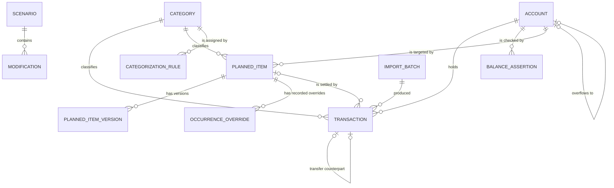

# Domain

This document defines the vocabulary of Demain, the entities and their relationships, the rules that must always hold, and the main algorithms (monthly synthesis, planned items, matching, scenario evaluation). The product context is in [PRODUCT.md](PRODUCT.md), the technical context in [ARCHITECTURE.md](ARCHITECTURE.md).

Entities are described as tables of fields, not as code. Field names are indicative; the final schema will be defined in M1.

## Glossary

| Term | Definition |
| --- | --- |
| **Account** | A place where money is held: checking account, Livret A, Livret Jeune, or any generic account the user creates. Each account has exactly one currency and an optional deposit ceiling. |
| **Transaction** | A real movement of money on one account at one date, usually imported from a bank export. Its kind is expense, income, interest or transfer leg. |
| **Transfer** | A movement between two of the user's own accounts, stored as two linked transactions (one outgoing, one incoming). A transfer into a savings account is a **savings flow**. Transfers are excluded from income and expense statistics. |
| **Deposit ceiling** | An optional maximum balance per account up to which deposits are accepted. Interest is exempt. See [Deposit ceiling and overflow](#deposit-ceiling-and-overflow). |
| **Overflow account** | The account that receives the part of a transfer that does not fit under another account's deposit ceiling. Overflow accounts can be chained. Cycles are not allowed. |
| **Category** | A user-defined label used to group transactions and planned items (Food, Rent, Salary, Subscriptions...). Categories are flat in V1. |
| **Categorization rule** | A user-defined condition on an imported transaction (for example, label contains a text) that assigns a category. |
| **Planned item** | A future movement the user expects and has dated explicitly: either a recurrence (has a repetition rule) or a firm one-off event (no repetition). Its amount and schedule are versioned by effective date. |
| **Occurrence** | One dated instance of a planned item. A one-off planned item has exactly one occurrence; a recurrence has one per repetition. Occurrences are computed on demand, not stored. |
| **Provision** | A planned item that accepts several transactions per occurrence (for example fuel: 90 EUR planned for the month, settled by several fill-ups). |
| **Rolling average** | An amount mode of a planned item: the amount of an occurrence is the average of the item's previous occurrence values. See [Amount of an occurrence](#amount-of-an-occurrence). |
| **Balance assertion** | A real balance the user records for an account at a date (for example, the balance shown on the bank website). It is compared with the computed balance to reveal unexplained gaps. |
| **Real trajectory** | What the app shows by default: real transactions up to today and, beyond today, only planned items that are explicitly dated. It never contains an estimation of spending the user did not plan. |
| **Estimation** | A value derived from the recent average of past spending, standing for spending the user has not planned. Estimations exist only inside simulations. |
| **Constant-pace simulation** | The reference simulation: the real trajectory plus estimated variable spending, with no modification. It answers "what if my life rhythm does not change". |
| **Scenario** | A named, hypothetical set of modifications applied on top of the constant-pace simulation. A scenario never changes real data until it is validated. |
| **Modification** | One change inside a scenario, of one of 8 types (subscription change, one-off purchase, loan, income change, savings goal, interest projection, category budget change, composite life event). |
| **Horizon** | The time range over which a simulation or a scenario comparison is computed (6, 12, 24 months or custom). |
| **Reference currency** | The single currency chosen by the user in which totals, simulations and scenario indicators are expressed. |
| **Exchange rate** | A dated conversion rate between two currencies, stored in the database. Entered by hand by default, optionally fetched from public ECB rates. |
| **Minor unit** | The smallest unit of a currency (the cent for EUR). All amounts are stored as integer counts of minor units and converted to a decimal only for display. |

## Entity model

### Overview

### Account

| Field | Description |
| --- | --- |
| id | Identifier. |
| name | Display name ("Checking", "Livret A"). |
| kind | `checking`, `savings` or `other`. Drives default display and which accounts count as savings. |
| currency | ISO 4217 code. Immutable once transactions exist. |
| opening_date, opening_balance | Starting point of the computed balance, in minor units. |
| deposit_ceiling | Optional, in minor units. Maximum balance up to which deposits are accepted. Null means no ceiling. |
| overflow_account_id | Optional. The account that receives the surplus of a transfer that does not fit under this account's ceiling. Must respect the [protection rules](#protection-of-the-chain). |
| archived | The account is closed: hidden from views but kept for history. See [Archiving an account](#archiving-an-account). |

### Archiving an account

An account that is no longer used is archived, not deleted, so that its history and the balances of past months stay correct.

- **Zero balance.** An account can be archived only when its computed balance is exactly zero. A negative balance blocks the archiving as well. The user empties the account first, typically with a transfer to another account.
- **No more entered movements.** No transaction can be entered on an archived account, and account pickers do not offer it. Its existing transactions can be neither edited nor deleted, since that would move its balance away from zero. A planned item cannot target it, and an account targeted by a planned item that is not over cannot be archived until the item is changed.
- **Balance assertions are frozen.** No balance assertion can be added, replaced or deleted on an archived account. The ones it already has stay visible, on its own page and on the page listing the assertions of every account, where they are shown as archived with the account. This state is derived from the account: an assertion has no archived field of its own.
- **Imports are the exception.** A transaction imported from the bank has already happened, so it is accepted on an archived account and flagged with a visible warning.
- **History stays.** Past transactions, balances and statistics of an archived account remain in the views that cover their period.

### Transaction

| Field | Description |
| --- | --- |
| id | Identifier. |
| account_id | The account it belongs to. Its currency is the account currency (no per-transaction currency). |
| date | Booking date as given by the bank, a calendar date without time or timezone. There is no separate value date in V1. |
| amount | Signed integer in minor units: negative leaves the account, positive enters it. |
| kind | `expense`, `income`, `interest` or `transfer`. |
| label | Raw label from the bank export, kept unchanged for rules and deduplication. |
| description | Optional user note. |
| payment_mode | Optional: card, transfer, direct debit (kept from the sheet and from imports when available). |
| category_id | Nullable. Null means the transaction is in the **to categorize** queue. Transfers have no category. |
| transfer_counterpart_id | For a transfer leg, the other leg. Null otherwise. |
| planned_item_id, occurrence_date | Set when the transaction settles an occurrence of a planned item (nominal date of that occurrence). Null otherwise. |
| import_batch_id | The import that created it, if any. |
| import_fingerprint | Value used to detect duplicates across imports, unique per account, carried by the leg of the account that receives the file (the first leg when the row is split into several transfers). It is the OFX identifier (`FITID`) when present, otherwise the content key: built from date, amount and normalized label (case and spacing ignored) plus the rank of the row among identical rows of the file, so that two genuine identical movements both survive and are both recognized the next time. Without a bank identifier, a movement identical to an earlier one that first appears in an export starting between them (same day, same amount, same label) cannot be told from the earlier one and is ignored as a duplicate: the preview shows the number of duplicates so that it can be checked. |
| import_content_key | The content key of every imported transaction, kept even when the bank gave an identifier. It lets the same movement exported again in the other format (CSV after OFX, OFX after CSV) be recognized. Bank identifiers stay authoritative between themselves: two OFX movements with the same content but other identifiers are both kept. |

### Category and categorization rule

| Category field | Description |
| --- | --- |
| id, name | Identifier and display name (translatable labels for default categories). |
| archived | Hidden from pickers but kept for history. |

- **Unique names.** Category names are unique regardless of case, archived categories included, so that two homonyms never coexist in the history or in a rule.
- **Archiving keeps the history.** An archived category stays on the transactions that already carry it and in the views of their period, but it is never newly assigned and does not appear in pickers. It can be reactivated: it is then offered again in the pickers and the rules that point to it apply again.
- **To-categorize queue.** An entered transaction without a category waits in the queue. A transfer has no category and is never in the queue.
- **Categorizing moves no balance.** It is allowed on a transaction of an archived account, unlike editing or deleting it.

| Rule field | Description |
| --- | --- |
| id | Identifier. |
| condition | Field (label in V1), operator (contains, starts with, equals) and value. Case-insensitive. |
| account_id | Optional restriction to one account. |
| category_id | Category assigned on match. |
| priority | Order of evaluation; the first matching rule wins. |

- **Rules apply to imports only.** A rule never changes a transaction already recorded, and creating or deleting a rule recategorizes nothing.
- **Archived categories.** A rule pointing to an archived category is kept but skipped, so the transaction goes to the to-categorize queue.
- **Order.** A new rule goes last; the user moves rules up or down, which swaps their priorities.

### Planned item and versions

| Planned item field | Description |
| --- | --- |
| id | Identifier. |
| name | "Rent", "Salary", "Music streaming", "Car insurance", "Fuel". |
| account_id, category_id | Target account and category. |
| kind | `expense`, `income`, `interest` or `transfer` (a planned savings transfer also names the destination account). |
| start_date | First nominal date. For a one-off item, its only date. |
| end_date | Optional last date for a recurrence. |
| accepts_multiple_transactions | True for a provision (several transactions settle one occurrence). Default false. |
| provision_label_filter | Optional text for a provision: only transactions whose label contains it are linked automatically (for example `carburant`). |
| match_window_days | Default 5. |
| match_amount_tolerance | Default 5%. |
| cancelled | A cancelled planned item produces no future occurrence. |
| source_scenario_id | Set when the item was created by validating a scenario. |

A planned item has one or more **versions**. A version applies from its `effective_from` date until the next version:

| Version field | Description |
| --- | --- |
| planned_item_id | Owner. |
| effective_from | Date from which this version applies. |
| repetition | Null for a one-off event. Otherwise one of: monthly on day N, monthly on last day, yearly, every N months, quarterly, every N weeks. |
| business_day_rule | Optional: none, previous business day, next business day. |
| amount | Signed integer in minor units: the fixed amount, or the starting estimate when the mode is rolling average. |
| amount_mode | `fixed` or `rolling_average`. |
| average_window | Number of previous occurrences averaged, 3 by default (configurable, for example 6 or 12). |

Examples:

- A salary has a version with amount 1143.88 and a later version with amount 1171.47, effective from the date of the raise. Occurrences before that date use 1143.88, occurrences on or after use 1171.47.
- A rent paid on the 5th moves to the 1st from March: a new version effective from March with the same amount and a new repetition. Occurrences before March keep the 5th. This is how "change all future dates of a subscription at once" works.

### Occurrence override

Occurrences are generated on the fly (see [invariants](#invariants)). Only the occurrences that the user changed individually are recorded:

| Field | Description |
| --- | --- |
| planned_item_id | Owner. |
| nominal_date | The date computed by the repetition rule, which identifies the occurrence. |
| status | `cancelled` (a single occurrence skipped without cancelling the whole item) or `modified`. |
| override_date | For `modified`: the date to use instead (a merchant delays one payment). Optional. |
| override_amount | For `modified`: the amount to use instead for this occurrence only. Optional. |

The user creates overrides from the calendar or from the monthly line view, on a single day, without touching the rest of the item.

### Occurrence status

Statuses are derived, never stored:

| Status | Condition |
| --- | --- |
| `planned` | Not cancelled, no transaction linked, matching window not yet passed. |
| `partial` | Provision only: some transactions are linked, the remaining amount is above zero, window not yet passed. |
| `confirmed` | At least one transaction is linked and the occurrence is settled: for a regular item as soon as its transaction is linked, for a provision when the linked sum reaches the amount or when the window has passed. |
| `overdue` | No transaction linked and matching window passed. |
| `cancelled` | The item or this single occurrence is cancelled. |

### Balance assertion

| Field | Description |
| --- | --- |
| account_id, date | Account and date of the observed balance (end of day). |
| amount | Real balance in minor units, as shown by the bank. |
| note | Optional. |

The app displays `computed balance at date - asserted amount` as the **unexplained gap**.

An import can record one at the end date of the file (the date of its last movement), and it replaces an assertion of the same day as any other assertion.

There is at most one assertion per account and date: recording the same day again replaces the earlier amount and note. The date cannot be before the opening date of the account, since the computed balance starts there. Recording a day that already has an assertion is announced to the user as a replacement. An assertion can be deleted while its account is active. The computed balance at a date is the opening balance plus every transaction of the account dated on or before that day.

The real account balances of the sheet's Summary tab become balance assertions through the same rules (a day that already has one is replaced, and announced as such). A Summary month gives one assertion, dated the **last day of the month** (leap years included), on the account chosen by the user. A month the sheet leaves without a balance creates nothing and is named, it is not an error. A month is **refused** when the account is archived, when the month ended before the opening date of the account, or when its last day is after today (the current month is not over, so its real balance is not known yet). Everything accepted is recorded in one transaction, all or nothing, after a preview that lists what would be created, replaced and refused. When two rows name the same month, the first is kept and the other is reported.

The `/balances/summary` screen does this in two steps: the file, the account (active accounts only) and an optional year give a preview, a table that says in text, for each month, whether its balance will be created, will replace the balance of that day (with the previous amount), is refused (with the reason) or is nothing to record; then an explicit second action records everything. The same screen compares the Summary with the history already stored in Demain, month by month (net, savings, cumulative savings, cumulative account, real savings balance), with the month-by-month comparison of the sheet figures. Only the months from the first to the last Summary month that is over are compared (the others are named), the savings balance is the sum of the balances of the accounts of kind savings, and a difference is shown as the two amounts and the signed gap (Demain minus the Summary), never by color alone. Tolerance is zero.

### Scenario and modification

| Scenario field | Description |
| --- | --- |
| id, name | Identifier and display name. |
| status | `draft` or `validated`. |
| validated_at | Date of validation, if any. |

The constant-pace simulation is not a stored scenario: it is the evaluation with an empty list of modifications, always available.

| Modification field | Description |
| --- | --- |
| id, scenario_id | Identifier and owner. |
| type | One of the 8 types listed in [Scenario evaluation](#scenario-evaluation-pipeline). |
| parameters | Type-specific parameters, validated by a schema per type. |
| parent_id | For a composite life event, the group modification that contains it. |

### Currency and exchange rate

| Settings field | Description |
| --- | --- |
| reference_currency | ISO 4217 code used for totals and simulations. |
| ecb_fetch_enabled | False by default. |

| Exchange rate field | Description |
| --- | --- |
| date | Date of validity. |
| base, quote | Currency pair. |
| rate | Exact value stored as an integer scaled by 10^8 (1.0821 is 108210000), never a binary float. Positive, at most 8 decimals. |
| source | `manual` or `ecb`. |

To convert an amount at a date, the app uses the most recent rate on or before that date, stored in either direction of the pair (a EUR to USD rate also converts USD to EUR). One rate per pair and day: entering the same day again replaces it, except that a rate fetched from the ECB never replaces one entered by hand. Future simulations use the most recent known rate.

### Import batch

| Field | Description |
| --- | --- |
| id | Identifier. |
| account_id | Target account. |
| format | `csv` or `ofx`. |
| imported_at, file_name | Traceability. |
| mapping | For CSV: the column mapping used, reusable for the next import from the same bank. |

## Invariants

These rules must hold at all times and are the first candidates for unit tests.

1. **Amounts are integers in minor units.** No floating-point value is ever stored or used for money arithmetic. Text amounts ("1 143,88 €") are parsed to integer minor units by string handling, never through a float, and converted back to a decimal string only for display and export. The number of decimals comes from the currency (2 for EUR). Division (averages, percentages, interest) rounds explicitly to the minor unit at a documented step.
2. **A transaction's currency is its account's currency.** Cross-currency views convert to the reference currency at read time using stored rates.
3. **A transfer is exactly two linked transactions** of opposite sign, on two different accounts, each pointing to the other. Deleting one deletes both. Transfers are excluded from income and expense statistics and from category statistics; transfers into savings accounts are reported as savings flows.
4. **Occurrences are generated, not stored.** The list of occurrences for any horizon is a pure function of the planned item (versions, business-day rule), its recorded overrides and its linked transactions. Changing a schedule from a date changes all later non-settled occurrences at once.
5. **A transaction settles at most one occurrence**, and an occurrence is settled by at most one transaction, except for a provision, which accepts several.
6. **The nominal rule is kept.** Matching never alters a planned item's rule; the real date and amount come from the matched transactions.
7. **Real data is never changed by a scenario** until the scenario is validated, and validation only creates or modifies planned items, never transactions.
8. **The computed balance of an account** at a date equals its opening balance plus the sum of its transactions up to and including that date.
9. **The real trajectory contains no estimation.** Beyond today it contains only explicitly dated planned items (whose amount may follow a rolling average chosen by the user for that item). Estimated variable spending exists only in simulations.
10. **The deposit ceiling holds for entered data.** See [Deposit ceiling and overflow](#deposit-ceiling-and-overflow).
11. **Overflow chains are acyclic**, stay within one currency, and are never saved with an archived account as target. An archived account keeps the link it had: it holds nothing and receives nothing, so the link is never evaluated.
12. **An archived account has a zero balance** and receives no entered transaction. See [Archiving an account](#archiving-an-account).

## Deposit ceiling and overflow

A ceiling limits the balance an account may reach through deposits. An account may also name an **overflow account**, which receives what does not fit. Overflow accounts can be chained: an account overflows to a second one, which overflows to a third, and so on.

### Rules

- The ceiling applies to the **balance** and to **deposits**: an incoming transfer, or an income entered on the account. **Interest is always accepted** and may bring the balance above the ceiling. Withdrawals lower the balance and free room.
- The **room** of an account is its ceiling minus its balance, never below zero.
- A transfer into an account that is full, or that would become full, is **split along the chain**: the part that fits goes to the destination account, the surplus goes to its overflow account whose own room is checked the same way, and so on. What fits nowhere **stays in the source account**: it is not transferred, and it is reported as unplaced.
- For a transfer **entered by hand**, the app shows the split before recording and offers: cancel; **deposit only the room** (the surplus is simply not transferred, as if the user had only typed that amount); or deposit the room and send the surplus to **an account chosen by the user** (the overflow account is pre-selected when there is one, and the same room check applies to the chosen account).
- For a **planned occurrence** and for a **simulated** transfer (including a savings goal), the split follows the overflow chain **automatically**: the occurrence does not exist yet, so nothing is asked. The result is shown in the calendar and in the simulation, with any unplaced surplus flagged.
- The **savings rows of an imported file** are split the same way, one after the other in date order, from the running balances of the accounts. What fits nowhere blocks the whole file, unless the user gives the account at the end of the chain an overflow account: the review shows the amount that does not fit, asks which account takes it, and the account chosen (or created, in the currency of the savings account) becomes that overflow account for good. The choice is only remembered in the review: the link, and the account when it is new, are written with the file, in the same transaction, and a refused or abandoned import writes neither. The review only asks when the account has a ceiling and no overflow account, never offers the account that receives the file, and the usual rules apply to the choice (no cycle, same currency, no archived target). A new question follows if the chosen account is full in turn and has no overflow account.
- An **income** that would exceed a ceiling is not routed, since the money has really arrived there. It is accepted with a warning.
- A transaction **imported from the bank is never changed**, since the movement already happened. It is accepted and flagged with a visible warning ("exceeds the declared ceiling: check it, or mark it as interest").

### Protection of the chain

The chain comes from user input, so it is never trusted:

- **No cycle.** Saving an overflow account is refused when following the chain from the chosen target would come back to the account itself (the account itself, A to B to A, or any longer loop). The check runs on the server at every save and on every load of external data, including a restored backup or a JSON import.
- **Same currency.** An overflow account must have the same currency as the account that overflows to it, since a transfer between currencies would need a conversion that V1 does not model. For the same reason, the currency of an account cannot change while an active account uses it as its overflow account.
- **Not archived.** An archived account cannot be chosen as an overflow account. An account that is the overflow account of an active account cannot be archived or deleted until that reference is changed. An archived account that still points to another account is ignored as a referrer: it cannot be edited any more, so counting it would lock its target for good.
- **Defensive evaluation.** Even if a cycle were present in stored data, evaluating a chain keeps the accounts already visited and stops at the first repeat. It reports the configuration as invalid and places nothing, so a computation can never loop.

### Examples

- A Livret Jeune with a ceiling of 1 600.00 EUR, a balance of 1 550.00 and the Livret A as overflow account. A transfer of 200.00 from checking is split into 50.00 to the Livret Jeune and 150.00 to the Livret A.
- Same Livret Jeune, and the Livret A has a ceiling of 22 950.00 EUR and a balance of 22 900.00. The same transfer is split into 50.00, 50.00 and 100.00 that stays in checking, reported as unplaced.

## Monthly synthesis

The sheet's monthly tabs become filters on a single list of transactions. For a given month and account set, Demain computes three views.

| View | Definition |
| --- | --- |
| **Net of the month** | Sum of `income` and `interest` transactions minus sum of `expense` transactions in the month. Transfers are excluded. This is the sheet's "Final balance". |
| **Savings of the month** | Sum of transfers from non-savings accounts into savings accounts in the month, minus transfers back out. |
| **End-of-month balances** | Computed balance of each account on the last day of the month, plus a total converted to the reference currency. |

How the figures are bounded:

- **Series.** It starts at the oldest month among the opening dates of the accounts and the dates of the transactions, and runs without gaps up to the month asked for. A month without movement is kept, with zero flows.
- **Accounts.** An account counts from the month of its opening date, with its opening balance and its transactions up to the last day of each month. Archived accounts stay in the months their history covers.
- **Savings legs.** Only the legs of a transfer on a savings account count, and only when the other end is not a savings account: a transfer between two savings accounts (an overflow, for instance) is neither a deposit nor a withdrawal.
- **Currencies.** Net, savings and totals are in the reference currency. Accounts in another currency are shown in their own currency. Their end-of-month balance enters the total converted at the rate in force on the last day of the month, and each net or savings flow is converted at the rate in force on its own date, each rounded to the minor unit on its own. A balance or a flow with no rate on or before its date is left out of the figures and its currency is reported for the month.

In the sheet, the Summary tab also tracked derived cumulative figures. Demain can show them as well:

- **Cumulative savings** = sum of savings of the month since the start.
- **Cumulative account** = sum of net of the month since the start minus cumulative savings. It is the change of the checking account since the start, assuming every flow goes through checking. In Demain, the checking end-of-month balance equals its opening balance plus this value, minus any unexplained gap.

### Worked example from the sheet

Figures from the sheet's Summary tab (EUR):

| Month | Net of the month (sheet "Final balance") | Savings of the month | Cumulative savings | Cumulative account |
| --- | ---: | ---: | ---: | ---: |
| January | 576.14 | 573.16 | 573.16 | 576.14 - 573.16 = **2.98** |
| February | 806.07 | 650.00 | 573.16 + 650.00 = **1223.16** | (576.14 + 806.07) - 1223.16 = 1382.21 - 1223.16 = **159.05** |

In minor units, January is `57614 - 57316 = 298` and February is `(57614 + 80607) - 122316 = 15905`. Once the history is imported, Demain must reproduce these numbers exactly; this is an acceptance test of M1 (see [ROADMAP.md](ROADMAP.md#m1-ledger)).

The sheet also had a real account balance and a real savings balance entered by hand each month. These become **balance assertions** at the last day of each month, and any difference with the computed balance appears as an unexplained gap instead of being silently overwritten.

### The real chart

The main diagram of the app, and the one the sheet already had: for each month end, two curves.

- **Checking**: total of the checking accounts at the end of the month.
- **Savings**: total of the savings accounts at the end of the month.

Both are in the reference currency and are computed from real transactions only, from the first month to the last complete month. Beyond today, the chart continues with explicitly dated planned items, drawn dashed and with a distinct marker so that real and planned values are never confused (not by color alone). No estimation is ever drawn. Every chart has an equivalent data table.

## Planned items and recurrence

### Generating occurrences

For a requested horizon `[from, to]`:

1. Enumerate nominal dates from `start_date`. Each date follows the repetition rule of the version in effect at that point: dates before a version's `effective_from` follow the previous version, dates from `effective_from` follow the new one. Stop at `end_date` or `to`.
   - "Monthly on day N" uses the last day of the month when the month is shorter than N (day 31 in February gives the 28th or 29th).
   - "Monthly on last day" always uses the last day.
2. Apply the business-day rule if set (move a date falling on a weekend to the previous or next weekday). Weekends only: public holidays are not handled in V1. The nominal date is still the identity of the occurrence.
3. Apply recorded overrides: a `cancelled` occurrence is removed, a `modified` one takes its `override_date` and/or `override_amount`.
4. Compute the amount of each occurrence (next section).
5. Link settling transactions and derive the status (see [Occurrence status](#occurrence-status)).

There is no maximum horizon: the computation is bounded only by what is displayed.

### Amount of an occurrence

Two modes, chosen per planned item version. **Fixed is the default.** The rolling average is an option the user turns on for a given item, and only then does it apply.

**Fixed.** The occurrence amount is the `amount` of the version in effect on its nominal date.

**Rolling average.** The `amount` of the version is only the starting estimate (typical for a new item, entered by hand). Then:

1. The **reference value** of a previous occurrence is the sum of its linked transactions when it is settled, or its own estimated amount when it is still in the future.
2. The **estimated amount** of an occurrence is the average of the reference values of the previous `average_window` occurrences (fewer when fewer exist). When there is no previous value, it is the starting estimate.
3. Occurrences that were **cancelled**, or that are **overdue** without a linked transaction, are skipped: they are not payments.
4. A new version effective from a date **restarts** the average: occurrences before that date are no longer part of the window, and the starting estimate of the new version applies again.
5. A manual amount override on one future occurrence is used for that occurrence only and does **not** feed the average of the next ones. Real payments do.
6. The average is computed in integer minor units and rounded to the nearest minor unit (ties away from zero) at every step.

Example with a window of 3 and a starting estimate of 90:

| Moment | Occurrence 1 | Occurrence 2 | Occurrence 3 | Occurrence 4 |
| --- | ---: | ---: | ---: | ---: |
| Nothing paid yet | 90 (starting estimate) | 90 (value of 1) | 90 (average of 1 and 2) | 90 (average of 1, 2 and 3) |
| Occurrence 1 paid 100 | 100 (real) | 100 | 100 | 100 |
| Occurrences 2 and 3 paid 110 and 120 | 100 (real) | 110 (real) | 120 (real) | 110 (average of 100, 110, 120) |

Because the window feeds on its own estimates, the long-term estimate converges to a weighted average that favors recent values rather than to the simple average of the last real values. With real values 80, 90 and 100, the next estimates are 90.00, 93.33, 94.44, 92.59, 93.46 and so on, converging to (80 + 2 x 90 + 3 x 100) / 6 = 93.33, whereas the simple average of the last three real values is 90.

### Provisions (several transactions for one occurrence)

A provision is a planned item with `accepts_multiple_transactions`, such as fuel planned at 90 EUR per month on the 15th, settled in reality by several fill-ups.

- **Period of an occurrence.** For an item repeating monthly, the calendar month of its nominal date. For other repetitions, from the day after the previous nominal date to its nominal date.
- **Linking.** Transactions on the same account, with the item's category, dated within the period and, when the provision has a label filter, whose label contains the filter text, are linked to the occurrence. The filter matters when a category mixes several things (a car category holding fuel, insurance and tolls). Each linked transaction can be unlinked, and any other transaction of the period can be linked, by hand.
- **Remaining amount.** `max(0, amount - sum of linked transactions)`. Only the remaining amount is counted at the occurrence date in the real trajectory.
- **After the window.** Once the period has passed, any leftover provision disappears (the occurrence is `confirmed` if at least one transaction was linked, `overdue` otherwise). Spending above the amount is simply real spending.
- The monthly total of linked transactions is the occurrence's reference value for a rolling average.

### Matching planned vs actual

Runs after each import, for each new non-transfer transaction (and for transfer legs against planned transfers). Regular items:

1. **Candidates.** Occurrences that are not yet settled or cancelled, on the same account, whose nominal (or business-day adjusted, or overridden) date is within `match_window_days` (default 5) of the transaction date, and whose expected amount is within `match_amount_tolerance` (default 5%) of the transaction amount, with the same sign.
2. **Decision.**
   - Exactly one candidate occurrence, and that occurrence is the only candidate for exactly this transaction: the match is **confirmed automatically**, and shown in the import summary where it can be undone.
   - Several candidates on either side (two similar subscriptions, two transactions of the same amount in the window): the possible pairs are **proposed for validation**. Nothing is matched silently.
   - No candidate: the transaction stays unmatched and follows the normal categorization flow.
3. **Effect of a confirmation.** The transaction is linked to the occurrence. If the planned item has a category and the transaction has none, the transaction inherits it.
4. **Unmatched occurrences** stay `planned` until the window has passed, then become `overdue`. The user can then match by hand, cancel the occurrence, or leave it.

Provisions follow the linking rules of the previous section instead of the window and tolerance. The window and tolerance of regular items are configurable per planned item, since some direct debits move by several days and some bills vary more than 5%.

## Estimated variable spending

This applies **only to simulations**. The real trajectory and the calendar never use it.

Categories driven by planned items (subscriptions, rent, salary, provisions) are projected from their rules. Variable spending that the user has not planned (groceries, leisure) is estimated from history:

- For each category, the estimated monthly amount is the average of the last 3 complete months (configurable to 6 or 12).
- Only transactions **not** linked to a planned item are included, so a subscription or a provision is never counted twice.
- The user can override the estimated amount of any category inside a simulation.
- For the current month, only what remains is estimated: the monthly estimate minus what was already spent this month, never below zero.
- The monthly estimate is spread **evenly over the remaining days** of the month, which only matters for the daily minimum balance indicator.

## Scenario evaluation pipeline

A simulation is evaluated in four steps, the same for every scenario (and for the constant-pace simulation) so that comparisons are fair.

1. **Build the constant-pace cash flows** over the horizon: real history up to today, then current computed balances, planned item occurrences (with their fixed or rolling-average amounts) and estimated variable spending, all as dated flows per account.
2. **Apply modifications** in order. Every modification type is a transformation of future cash flows: it adds flows, removes flows, or scales flows. The 8 types differ only by their input form:

   | # | Type | Inputs | Transformation |
   | --- | --- | --- | --- |
   | 1 | Subscription change | Planned item or new subscription, mode (monthly, yearly, none), amount, start date | Removes the existing flows from the start date, adds the new ones. |
   | 2 | One-off purchase | Date, amount, account | Adds one flow. |
   | 3 | Instalments or loan | Principal, duration, annual rate, start date | Adds the principal as an inflow if it is a loan (optional), then constant periodic payments computed with the standard amortization formula (zero rate gives equal instalments). |
   | 4 | Income change | Planned income item or new income, new amount or end date, effective date | Modifies or ends income flows, or adds new ones. |
   | 5 | Savings goal | Target amount, target date, savings account; or monthly amount | Adds monthly transfers to the savings account, split along the overflow chain when a ceiling is reached (the result reports any surplus that fits nowhere, and goals that cannot be reached). Inverse mode computes the monthly amount needed to reach the target by the date, rounded up to the minor unit. |
   | 6 | Interest projection | Savings account, annual rate entered by the user, crediting frequency | Adds interest flows computed on the projected balance. Interest is not limited by the deposit ceiling. The calculation method of regulated French accounts (fortnight rules) is not reproduced in V1; this is an estimate. |
   | 7 | Category budget change | Category, percentage or new monthly amount, start date | Scales the estimated variable flows of that category. |
   | 8 | Composite life event | Name, list of modifications of types 1 to 7 | Applies its children in order. |

3. **Convert and aggregate.** Flows are converted to the reference currency with the latest known rate and aggregated into daily and monthly balances.
4. **Compute indicators** for the horizon:

   | Indicator | Definition |
   | --- | --- |
   | Final balance | Total balance on the last day of the horizon. |
   | Minimum balance and its date | Lowest daily total balance and the first day it is reached. |
   | Savings at a date | Total of savings accounts on a user-chosen date. |
   | Month-end curves | Month-end checking total and month-end savings total, for each month of the horizon. |
   | Total cost | Sum of outflows added or changed by the scenario minus the constant-pace equivalent, over the horizon. |

2 to 4 scenarios are evaluated with the same real history, horizon and settings, and displayed side by side.

### Comparison and diagrams

- **Shared real history.** All simulations share the same real months up to today, drawn once. Each simulation diverges from today, including the constant-pace simulation, which is always present as the fair reference. The real chart of the app is therefore the left part of every simulation chart.
- **Diagrams** available for a simulation and in the comparison: (1) the month-end checking and savings curves, the main one; (2) income and expenses per month as bars; (3) breakdown of expenses by category; (4) a comparison table (final balance, minimum balance and its date, total cost). Every diagram has an equivalent data table and never relies on color alone.

**Validation.** Validating a scenario converts each modification into planned item changes (new planned items, new versions, end dates). Modifications that do not describe a future flow by themselves (type 7 changes an estimate, not a planned item) are listed to the user with how they will be applied, before confirmation.

## Guessing the type of an imported row

A bank export rarely says whether a row is an expense, an income or savings. The type is guessed in layers, from the most to the least reliable, by a pure function (`guessMovementType`) that receives the signals of the row and the context (vocabulary and history) and returns the type, the evidence it rests on and a confidence.

### Layers

1. **An explicit type cell.** A cell read by the same reader as the import (`Expense`, `Depense`, `Income` and `Revenu`, singular or plural; `Savings`, `Saving` and `Epargne`, but not `Epargnes`) gives the type.
2. **The direction of the amount.** Separate debit and credit columns, or the sign of a single amount column: negative leaves the account (expense or savings), positive enters it (income).
3. **The vocabulary of the category.** The first whole word of the category cell that the vocabulary knows (for example `salaire` gives an income, `epargne` gives savings). Words are compared after removing accents and case, never as parts of a longer word.
4. **The history.** The type given to the same label (compared without case and extra spaces) by earlier imports of the account. The category word comes before the history.

The explicit type also wins in the review of an import, whether it comes from the type cell or from the type the user chose in the dialog. When it contradicts the sign of the amount, the disagreement is kept as a conflict to show: the row is marked "to confirm" in text with its reason, the file is not blocked, and the amount is recorded with the sign of the type (an expense is negative, an income is positive, the absolute value is kept). The amount cell shows that recorded amount (`-50.00` for an expense read on `+50,00`), and the duplicate fingerprints are computed on it, so that the same file imported again is recognized. Savings are not concerned, since they go both ways. A row without an explicit type is still typed by the sign.

A layer below the first two only counts when it agrees with the direction: an outgoing amount accepts an expense or savings, an incoming one accepts an income or savings (an incoming savings row is a withdrawal from the savings account, no longer a conflict). When it disagrees, the direction wins and the disagreement is kept as the conflict, to be shown. When the file has no direction at all (every amount positive in a single column), no conflict can be detected and the clue is used as it is.

### Confidence

There are three levels, and no number: `high`, `medium` and `low`. Only `low` flags the row "to confirm", in text and never by color alone. A `medium` guess shows its reason ("guessed: category is salaire") without the flag.

| Situation | Type | Confidence |
| --- | --- | --- |
| Type cell, and the direction agrees or is unknown | The cell | High |
| Type cell that contradicts the direction | The cell: an explicit type wins over the sign, and the recorded sign follows the type | Low, with the sign as the conflict |
| No type cell; a category word or the history agrees with the direction | The clue | Medium |
| No type cell; the direction only | Expense when outgoing, income when incoming | Medium |
| No type cell; a clue contradicts the direction | By the direction | Low, with the clue as the conflict |
| No direction; a clue | The clue | Low |
| Nothing at all | Expense | Low |

When the file has a type column but a cell is empty or names no known type, the cell is ignored (the unknown text is kept aside to be shown), the other layers apply as above and the confidence is forced to `low`.

### Vocabulary

The default vocabulary is fixed, in French and in English, without accents and in lowercase:

- Income: `salaire`, `salaires`, `salary`, `salaries`, `paie`, `paye`, `payroll`, `revenu`, `revenus`, `income`, `allocation`, `allocations`, `caf`, `dividende`, `dividendes`, `dividend`, `dividends`.
- Savings: `epargne`, `epargnes`, `savings`, `saving`, `livret`, `livrets`, `ldds`, `lep`, `pel`, `cel`.

There is no expense word: an outgoing amount is an expense unless something says otherwise. Ambiguous words (a bonus, a pension, a grant) are left out on purpose.

The vocabulary and the history are inputs of the function, like the rest of the data. The default vocabulary is what is used today; enriching it from the history, letting the user edit it and reading the history of the account are wired in later changes.

## Reading any CSV file

One reader (`readMovementFile`) serves the import. It analyzes the layout of the file, then reads each row into a date, a label, a signed amount and, when the file has them, a type guess (see above), a category, a payment mode and a description.

### Blocks

A CSV file often holds more than the table of movements. What is not a movement is left out and reported with its place, never dropped silently.

- **Lines above the header.** The header is the first line that names a date, a label and an amount (or a debit and a credit). Lines above it (an account name, a balance at a date) are ignored, and the line numbers stay those of the file.
- **A block beside the table.** Columns that are empty on every line from the header on split the file into blocks. The table is the block that holds the date, label and amount columns; the columns of the other blocks (a monthly summary with its revenues, expenses and savings, for instance) are ignored, whatever they hold. A column that has a header and no value does not split the table. When the three columns are not in one block, nothing is left out.
- **Total rows.** A row whose date cannot be read and where a cell of the table starts with a total word (`total`, `totals`, `sous-total`, `subtotal`, `totaux`, `solde`, `balance`, `sum`) is ignored. The word is read whole: `Sum` is a total, `SumUp` and `Summer camp` are not. A row with a readable date is kept whatever its label says ("TOTAL ENERGIES"), and so is a date written without a year.
- **Empty lines.** A line that holds nothing in the table (only a block beside it) is skipped without a report.

### Number format

The decimal mark is read per file, from its amount cells, and applies to all of them: the other mark only groups digits, and an amount that breaks it is rejected like any unreadable amount. A cell is a clue when it holds both marks (the last one is decimal), when a mark is repeated (it groups), or when a lone mark is followed by other than three digits. A lone mark followed by exactly three digits (`1,234`, `1.234`) is no clue, since it is a thousand in one convention and a decimal in the other: the mark of the file settles it, so `1.234` is 1 234.00 in a file that writes `-12,50`. The mark most cells point to wins, the comma on a tie; when the cells disagree the file is reported to be checked, with an example (`1 234,56` or `1,234.56`). Without any clue (whole amounts only), each amount is read on its own, as before.

### Columns named by their header

The type, the payment mode, the category and the description are looked for by the name of their header, in French and in English, then by their values.

| Role | Header words | Values |
| --- | --- | --- |
| Type | `type` | The column is accepted with a single known cell; the others are reported. |
| Payment mode | `paiement`, `payment` | Same. `CB`, `PRLV` and `VIR` (and their `SEPA` forms) are read as card, direct debit and transfer. |
| Category | `categor`, `rubrique` | Wins over the column with the fewest distinct values. |
| Description | `description`, `note`, `comment`, `memo`, `detail`, `remarque` | Header only, never the label column; not reported when absent. |

The columns are settled in this order: type, payment mode, then the category named by a header, then the description, then the category guessed from the values. A column named as the description is therefore never taken for the category, even when its values repeat like categories do (a `Note` column holding `perso` and `pro`).

The values always have the last word: a `Type` column that holds `CB` and `VIR` is the payment mode column. A header named `Description` gives the label  and a second text column named like a description gives the description.

### Label from the category

A row whose label is empty and whose category is filled takes the category as label, and is reported. A row with neither stays unreadable.

## Importing files

An import records the movements of a bank file on an account that may already hold transactions. See ADR-016 and, for the history of the sheet, Migration from the sheet.

- **Savings go both ways.** A negative amount typed as savings is a deposit: the money leaves the account of the file and is split along the overflow chain of the savings account, one linked pair of transfers per part. A positive amount typed as savings is a withdrawal: a transfer from the savings account to the account of the file.
- **Date order.** The rows of a file, and the files of one import, are taken in date order so that the ceilings are read from the balances as they were.
- **One file, one batch, all or nothing.** Each file is recorded in one transaction under its own batch, and deduplicated against the account that receives it. A part that fits nowhere, a loop in the chain or a row the ledger refuses records nothing of the file.
- **Not the first run.** An account that already has transactions is accepted.
- **Review before recording.** Any file opens a review, nothing is recorded until a file is imported. The account that receives the files can be changed there (the files are read again) and a savings account, the head of the overflow chain when there is exactly one, is the default of the savings rows that name none; only an active savings account of the same currency other than the receiving account is offered. The type, category (not for savings), payment mode and savings account of each row can be edited, alone or for the selected rows at once (the rules of a single row apply to each), the column that holds the type, the payment mode, the category and the description of a CSV file can be reassigned (the file is read again with the same reader; the type, category, savings account and texts changed on a row follow its line number in the file, a change whose line is no longer read is dropped and counted in text, and a file whose new reading failed keeps its rows but cannot be imported until a reading succeeds, and a "Read the file again" action retries with the assignment shown; changing the account reads every file again with its own columns and applies the same rule to the edits: they follow their line number, and those whose line is no longer read are dropped and counted in text), the rows to confirm can be shown alone, and the savings split planned from the balances is shown as text before the import. A type that contradicts the sign of the amount does not block the file: the type wins, the amount is recorded with the sign of the type and the row is marked "to confirm" in text with its reason. A row typed with a low confidence is marked "to confirm" in text with its reason. A file can be imported only when every earlier file (by first date) is imported, cancelled or failed, since each is planned from the balances the previous one leaves. The server reads every text again and plans from the real balances: what the review shows is a preview.
- **Balance at the end of a file.** Once a file is recorded, the real balance the bank shows at its end can be entered on the card of the file. The end date is the date of the last movement of the file, not today. Demain computes the balance of the account on that day (opening balance plus every movement dated on or before it, as for a balance assertion) and shows the gap in text: Demain holds more, less or the same as the bank. The amount is read from the typed text without rounding, and nothing is written.
- **Gap with the balance assertions of a file (domain).** For each file under review, the assertions that fall in the period of the file (first to last readable row, bounds included, rows the account already holds counted) are compared with the balance each account would have once the file is recorded: the stored transactions plus the movements of the new rows, computed on the same plan as the review, so a savings row counts for both sides of every part and a row already held counts once. Only the receiving account and the accounts the file moves are checked, and only active accounts: an archived account is frozen and its assertions are ignored. The tolerance is zero: any difference is a gap, written in text with its date, the real balance, the computed balance and the direction. The result also counts the assertions that match out of those checked. Nothing is written. Each file card of the import review shows it: a summary ("2 of 3 assertions match", announced politely), then a table with the account, the date, the real balance, the computed balance and the gap, which is always written (signed amount and who holds more), never by color alone, or a message when no assertion falls in the period. Files are compared in order: a file counts the movements of the files before it, cancelled ones excepted, and not those of the files after it. The comparison uses the assertions and the transactions read when the files were read, so an import made meanwhile does not count twice, and the figures follow every edit made in the review.
- **Rules proposed from a file.** Once a file is recorded, the distinct pairs (label, category) carried by its categorized rows (whatever set the category: a column of the file, an edit in the review, a rule or a manual choice; no pair is treated as confirmed) are proposed as rules for the account of the file: operator `equals` on the label as the matcher reads it (trimmed, lowercased). Transfers and rows without a category are ignored, and a pair that an applicable rule already gives that category to is not proposed. A pair that an existing rule of another category matches first is still proposed, with a warning in text, because rules are first match wins and a new rule goes last: it would never apply until moved up (the order is not changed for the user). Nothing is created without the user's selection (all boxes start unchecked); the server derives the proposals again from the batch and ignores any selected key it does not propose.
- **Undoing a file.** A recorded file can be undone as a whole while nothing in it has changed since it was recorded: every transaction of the batch (both legs of a transfer included) and the batch itself are removed in one operation. Each batch keeps a digest of its transactions taken when it was recorded, and the undo is refused, with nothing removed, when the transactions no longer hash to it (one was edited, categorized, moved or deleted), when the batch was recorded before undo existed (no digest, so it cannot be verified), or when an account it touches is archived. An edit reverted to the imported values does not count as a change. The categorization rules, the balance assertions and the overflow accounts created with the file stay. Once undone, the same file can be imported again, since the fingerprints leave with the rows (ADR-017).

## Migration from the sheet

Historical note. The history of the sheet (January to October 2026) was brought into Demain once, and the dedicated `/migration` screen that did it was retired (ADR-018). What remains of it is part of the general rules:

- The monthly tabs are read like any other CSV file by the import (see Importing files and Reading any CSV file). Savings rows are split along the overflow chain of the savings accounts (see Overflow chains); the owner's rule was to fill the Livret Jeune up to its ceiling of 1 600.00 EUR, then the Livret A, so that the January row of 573.16 gives 123.16 and 450.00.
- The opening balances are set when an account is created. The sheet's constants were `Base_compte` (56.27, checking) and `Base_epargne` (1 476.84, Livret Jeune; the Livret A starts at 0), and 56.27 + 2.98 (January cumulative account) = 59.25 is the "real account" value of January in the sheet.
- The Summary tab is not a source of transactions. Its real account balances become balance assertions through `/balances/summary`, and its other figures are compared month by month with the stored history there (see Balance assertion).
- The 2027 tabs are ignored: they are copies of the template, and planned items replace them.
- Repeating an import is harmless: the rows are deduplicated against the account (ADR-016).
